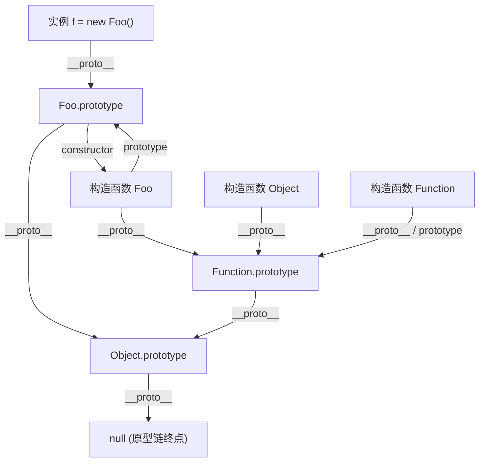

# 现代前端开发岗位高频面试题与权威题解（上篇：JS / TS / CSS / 浏览器 / 网络与安全）

---

## 目录
- [一、JavaScript 深度原理与运行时机制](#一javascript-深度原理与运行时机制)
  - [Q1: 详述执行上下文、作用域链与闭包的底层内存模型，V8 是如何优化闭包的？哪些场景会导致闭包内存泄漏及如何排查？](#q1-详述执行上下文作用域链与闭包的底层内存模型v8-是如何优化闭包的哪些场景会导致闭包内存泄漏及如何排查)
  - [Q2: 彻底讲透原型与原型链：`prototype`、`__proto__`、`constructor` 的三角关系，以及 ES6 `class extends` 与 ES5 寄生组合继承的底层差异](#q2-彻底讲透原型与原型链prototype__proto__constructor-的三角关系以及-es6-class-extends-与-es5-寄生组合继承的底层差异)
  - [Q3: `this` 绑定的四条规则与优先级是什么？箭头函数的本质是什么？如何手写工业级的 `call`、`apply` 与 `bind`？](#q3-this-绑定的四条规则与优先级是什么箭头函数的本质是什么如何手写工业级的-callapply-与-bind)
  - [Q4: 深度剖析浏览器与 Node.js 的 Event Loop（事件循环）机制，微任务与宏任务的执行时机与 UI 渲染帧的关系是什么？](#q4-深度剖析浏览器与-nodejs-的-event-loop事件循环机制微任务与宏任务的执行时机与-ui-渲染帧的关系是什么)
  - [Q5: Promise/A+ 规范的核心状态机机制是什么？`async/await` 的底层编译原理（Generator + 自动执行器）是怎样的？](#q5-promisea-规范的核心状态机机制是什么asyncawait-的底层编译原理generator--自动执行器是怎样的)
  - [Q6: 详解 V8 引擎的垃圾回收（GC）机制：代际假说、新生代 Scavenge、老生代标记清除/整理，以及 Orinoco 并发/增量三色标记与写屏障](#q6-详解-v8-引擎的垃圾回收gc机制代际假说新生代-scavenge老生代标记清除整理以及-orinoco-并发增量三色标记与写屏障)
- [二、TypeScript 高级类型系统与类型体操](#二typescript-高级类型系统与类型体操)
  - [Q7: `interface` 与 `type` 的核心区别？`any`、`unknown`、`never`、`void` 在类型层级（Type Hierarchy）中处于什么位置？](#q7-interface-与-type-的核心区别anyunknownnevervoid-在类型层级type-hierarchy中处于什么位置)
  - [Q8: 什么是类型的协变（Covariance）与逆变（Contravariance）？为什么 TypeScript 中函数参数是逆变的？](#q8-什么是类型的协变covariance与逆变contravariance为什么-typescript-中函数参数是逆变的)
  - [Q9: 掌握分布式条件类型、`infer` 推导与映射类型：手写高频内置工具类型及递归 `DeepReadonly` / `DeepPartial`](#q9-掌握分布式条件类型infer-推导与映射类型手写高频内置工具类型及递归-deepreadonly--deeppartial)
- [三、HTML5 与现代 CSS 核心八股与渲染性能](#三html5-与现代-css-核心八股与渲染性能)
  - [Q10: 什么是 BFC（块级格式化上下文）？触发条件、布局规则及三大经典应用场景是什么？](#q10-什么是-bfc块级格式化上下文触发条件布局规则及三大经典应用场景是什么)
  - [Q11: 深入理解 Flex 布局（`flex: 1` 的真实含义与空间分配计算公式）与层叠上下文（Stacking Context）中的 `z-index` 失效问题](#q11-深入理解-flex-布局flex-1-的真实含义与空间分配计算公式与层叠上下文stacking-context中的-z-index-失效问题)
  - [Q12: 什么是重排（Reflow）与重绘（Repaint）？CSS 硬件加速与合成层（Composite Layer）的原理及“层爆炸”如何治理？](#q12-什么是重排reflow与重绘repaintcss-硬件加速与合成层composite-layer的原理及层爆炸如何治理)
- [四、浏览器内核原理、存储与跨标签通信](#四浏览器内核原理存储与跨标签通信)
  - [Q13: 从在浏览器地址栏输入 URL 到页面完全渲染上屏，全链路发生了什么？（深入到渲染主线程与合成线程管线）](#q13-从在浏览器地址栏输入-url-到页面完全渲染上屏全链路发生了什么深入到渲染主线程与合成线程管线)
  - [Q14: `<script>` 标签中默认、`async`、`defer` 以及 `type="module"` 的加载与执行时机有何核心区别？](#q14-script-标签中默认asyncdefer-以及-typemodule-的加载与执行时机有何核心区别)
  - [Q15: 浏览器本地存储方案全对比（Cookie / Web Storage / IndexedDB / OPFS），以及同源跨标签页通信的 6 种实现方案](#q15-浏览器本地存储方案全对比cookie--web-storage--indexeddb--opfs以及同源跨标签页通信的-6-种实现方案)
- [五、计算机网络与前端安全攻防体系](#五计算机网络与前端安全攻防体系)
  - [Q16: 深度对比 HTTP/1.1、HTTP/2、HTTP/3 (QUIC)：为什么 HTTP/2 依然存在队头阻塞？HTTP/3 是如何彻底解决的？](#q16-深度对比-http11http2http3-quic为什么-http2-依然存在队头阻塞http3-是如何彻底解决的)
  - [Q17: 彻底讲透浏览器缓存机制：强缓存与协商缓存的完整决策树、状态码（200 from disk/memory cache vs 304）与最佳实践](#q17-彻底讲透浏览器缓存机制强缓存与协商缓存的完整决策树状态码200-from-diskmemory-cache-vs-304与最佳实践)
  - [Q18: 详解同源策略与跨域（CORS 简单请求 vs 预检请求），以及 XSS、CSRF 的攻击原理与工业级防御体系](#q18-详解同源策略与跨域cors-简单请求-vs-预检请求以及-xsscsrf-的攻击原理与工业级防御体系)

---

## 一、JavaScript 深度原理与运行时机制

### Q1: 详述执行上下文、作用域链与闭包的底层内存模型，V8 是如何优化闭包的？哪些场景会导致闭包内存泄漏及如何排查？

#### 【考点分析】
面试官不仅想听“函数套函数”，而是考察应聘者对**词法环境（Lexical Environment）**、**V8 堆内存 Context 对象**、**Pre-parser 预解析自由变量捕获机制**以及线上内存泄漏排查方法论的掌握深度。

#### 【标准答案】
1. **执行上下文（Execution Context）与词法环境**：
   - 每当 JS 代码执行时，都会进入一个执行上下文（全局执行上下文、函数执行上下文、eval 执行上下文），并压入**调用栈（Call Stack）**。
   - 在 ES6+ 规范中，每个执行上下文包含：
     - **词法环境（Lexical Environment）**：存储 `let`/`const`、函数声明及代码块作用域。由**环境记录器（Environment Record）**和**对外部词法环境的引用（outer）**组成。
     - **变量环境（Variable Environment）**：专门存储 `var` 声明的变量（存在变量提升，初始值为 `undefined`）。
   - **作用域链（Scope Chain）**：由当前环境记录器沿着 `outer` 指针逐级向上查找的链条。**注意：`outer` 指向由函数定义时的词法位置决定（静态词法作用域），而非调用位置。**

2. **闭包的底层内存模型与 V8 优化（Pre-parser 与 Context 分配）**：
   - **定义**：闭包是指有权访问另一个函数作用域中**自由变量（Free Variables）**的函数，本质上是**函数实例及其捆绑的词法环境引用（`[[Environment]]`）的组合**。
   - **V8 是如何实现的？**
     - 默认情况下，函数的局部变量分配在**栈内存（Stack）**上，函数出栈即销毁。
     - 当 V8 引擎执行外部函数时，其快速的 **Pre-parser（预解析器）**会扫描内部函数。如果发现内部函数引用了外部函数的变量 `a`，V8 不会把 `a` 分配在栈上，而是在**堆内存（Heap）**中创建一个专门的 `Closure Context` 对象，把被捕获的变量 `a` 放进去；未被内部函数引用的局部变量 `b` 则依然留在栈上，随外部函数出栈立即销毁。

3. **经典的 V8 共享闭包 Context 内存泄漏陷阱**：
   ```javascript
   function createClosureTrap() {
     const hugeData = new Array(10 * 1024 * 1024).fill('X'); // 约 80MB 大对象
     const smallVar = 'hello';

     // unused 引用了 hugeData，虽然 unused 自身没被返回，但迫使 hugeData 进入了共享的堆 Context！
     function unused() {
       console.log(hugeData.length);
     }

     // 被返回的 inner 函数持有了同一个共享 Closure Context 的引用
     return function inner() {
       return smallVar;
     };
   }
   const fn = createClosureTrap(); // 只要 fn 存活，hugeData 就永远无法被 GC 回收！
   ```
   - **成因**：同一父函数下的多个子函数会**共享同一个 `Closure Context`**。即使返回的 `inner` 只用了 `smallVar`，但兄弟函数 `unused` 在语法上引用了 `hugeData`，导致 `hugeData` 被打包进同一个 Context，造成隐蔽的内存泄漏。
   - **其他常见泄漏场景**：
     1. 组件卸载后未清理的定时器（`setInterval`）、全局事件监听（`window.addEventListener`）、EventBus 订阅回调中持有了组件实例或状态引用。
     2. 脱离 DOM 树的节点引用（Detached DOM Elements）：JS 变量或闭包仍持有已被 `removeChild` 的 DOM 节点，导致整棵子树无法回收。
     3. 无淘汰策略的全局 Map / Object 缓存（应改用 `WeakMap` / `WeakSet` 或 LRU 缓存）。

4. **排查流程（Chrome DevTools Memory 面板）**：
   - **第一步（Performance Monitor）**：打开实时监视器，反复执行可疑操作（如打开关闭弹窗/切换路由），观察 `JS Heap Size` 和 `DOM Nodes` 是否呈阶梯状只增不减。
   - **第二步（Heap Snapshot 对比法）**：
     1. 先手动点击小垃圾桶执行一次强制 GC，拍下基准快照 `Snapshot 1`。
     2. 执行可疑交互操作并还原到初始界面，再次强制 GC，拍下快照 `Snapshot 2`。
     3. 视图切换为 **Comparison（对比模式）**，按 `# Delta` 或 `Size Delta` 降序排列，或者筛选 `Detached` 关键字。
   - **第三步（Retainers 引用链追踪）**：在底部 `Retainers` 面板查看 `Distance`（到 GC Root 的最短距离），顺着 `context in ()` 找到具体持有了该对象的闭包函数及源码行号。

---

### Q2: 彻底讲透原型与原型链：`prototype`、`__proto__`、`constructor` 的三角关系，以及 ES6 `class extends` 与 ES5 寄生组合继承的底层差异

#### 【考点分析】
考察 JavaScript 面向对象机制的根基，尤其是 `Function.__proto__ === Function.prototype` 等边界关系，以及 ES6 继承与 ES5 继承在**实例创建顺序**和**原生构造函数（如 `Array`、`Error`）继承**上的本质区别。

#### 【标准答案】
1. **核心三角关系与黄金铁律**：
   - 每个**函数（除箭头函数外）**都有一个显式原型属性 `prototype`（指向一个原型对象）。
   - 每个**实例对象**都有一个隐式原型内部槽 `[[Prototype]]`（浏览器暴露为 `__proto__`，标准 API 为 `Object.getPrototypeOf(obj)`）。
   - **铁律 1**：实例的隐式原型指向其构造函数的显式原型：`instance.__proto__ === Constructor.prototype`。
   - **铁律 2**：原型对象上默认有一个 `constructor` 属性指回构造函数本身：`Constructor.prototype.constructor === Constructor`。
   - **铁律 3（原型链终点）**：普通原型对象本质是由 `Object` 构造的，所以 `Constructor.prototype.__proto__ === Object.prototype`，而 `Object.prototype.__proto__ === null`。
   - **铁律 4（函数的祖先）**：所有构造函数（包括 `Object` 和 `Function` 自身）都是 `Function` 的实例，因此：
     - `Object.__proto__ === Function.prototype`
     - `Function.__proto__ === Function.prototype`
     - `Function.prototype.__proto__ === Object.prototype`



2. **`new` 运算符的底层 4 步实现与手写**：
   ```javascript
   function myNew(Constructor, ...args) {
     if (typeof Constructor !== 'function' || !Constructor.prototype) {
       throw new TypeError('Constructor must be a constructable function');
     }
     // 1. 以构造函数的 prototype 为原型创建新对象
     const instance = Object.create(Constructor.prototype);
     // 2. 将新对象作为 this 执行构造函数
     const result = Constructor.apply(instance, args);
     // 3. 若构造函数显式返回了引用类型（对象或函数），则返回该结果；否则返回新创建的 instance
     const isObject = typeof result === 'object' && result !== null;
     const isFunction = typeof result === 'function';
     return isObject || isFunction ? result : instance;
   }
   ```

3. **ES5 寄生组合式继承 vs ES6 `class extends` 的三大核心差异**：
   - **差异一：`this` 对象的创建顺序完全相反（最关键！）**
     - **ES5 寄生组合继承**：**先由子类创建自己的实例 `this`**，然后再通过 `Parent.apply(this, args)` 把父类的属性往子类的 `this` 上挂载（**先子后父**）。因此，ES5 无法完美继承原生内置构造函数（如 `Array`、`Error`、`HTMLElement`），因为原生对象的内部插槽（如数组的 `[[ArrayLength]]`）无法通过 `Array.apply(this)` 绑定到普通对象上。
     - **ES6 `class extends`**：必须先调用 `super(...args)`，底层是**先由父类构造函数创建实例 `this`**（相当于 `Reflect.construct(Parent, args, Child)`），然后再用子类的构造函数修饰这个 `this`（**先父后子**）。这也是为什么子类 constructor 中在调用 `super()` 之前访问 `this` 会直接抛出 `ReferenceError`，且 ES6 可以完美继承 `Array`、`Error` 等内置类。
   - **差异二：静态属性与方法的继承链**
     - ES6 `class B extends A` 会同时建立两条原型链：
       1. 实例方法链：`B.prototype.__proto__ === A.prototype`
       2. 静态方法链：`B.__proto__ === A`（子类直接继承父类的静态方法）
     - ES5 寄生组合继承默认只用 `Object.create(A.prototype)` 连接了实例原型链，除非手动执行 `Object.setPrototypeOf(B, A)`，否则不会继承父类的静态属性。
   - **差异三：方法可枚举性与调用限制**
     - ES6 `class` 原型上的方法默认是**不可枚举**的（`enumerable: false`），且类本身必须通过 `new` 调用，直接调用会报错；ES5 挂载在 `prototype` 上的普通函数默认是可枚举的（`enumerable: true`）。

---

### Q3: `this` 绑定的四条规则与优先级是什么？箭头函数的本质是什么？如何手写工业级的 `call`、`apply` 与 `bind`？

#### 【考点分析】
考察动态作用域行为（`this`）的判断准确率，以及在手写 `bind` 时是否考虑了**柯里化传参**和**被当作构造函数 `new` 调用时 `this` 绑定失效但参数依然生效**的高阶边界条件。

#### 【标准答案】
1. **`this` 绑定的四条规则与优先级（从高到低）**：
   - **第一优先级：`new` 绑定**。`const obj = new Foo()`，`this` 指向新创建的实例对象。
   - **第二优先级：显式绑定（`call` / `apply` / `bind`）**。`this` 指向传入的第一个参数（非严格模式下传入 `null`/`undefined` 会指向全局对象 `window`/`globalThis`，传入原始值会被包装为对象；严格模式下保持原样）。
   - **第三优先级：隐式绑定（上下文对象调用）**。`obj.fn()`，`this` 指向最后一层调用点前的对象 `obj`。注意隐式丢失问题（如 `const f = obj.fn; f()` 或作为回调函数传参时，退化为默认绑定）。
   - **第四优先级：默认绑定（独立函数调用）**。严格模式（`'use strict'`）下为 `undefined`，非严格模式下为全局对象（浏览器中为 `window`）。

2. **箭头函数的本质特性**：
   - 箭头函数**没有自己的 `this`、`arguments`、`super`、`new.target`**。
   - 它的 `this` 在定义时从外层词法作用域继承，且**一旦绑定永不可变**（`call`/`apply`/`bind` 无法改变箭头函数的 `this`，只会忽略第一个参数并正常传递后续参数）。
   - 箭头函数没有 `prototype` 属性，不能使用 `new` 关键字作为构造函数调用，也不能用作 Generator 函数。

3. **手写工业级 `call`、`apply`、`bind`**：
   ```javascript
   // 1. 手写 Function.prototype.myCall
   Function.prototype.myCall = function (context, ...args) {
     if (typeof this !== 'function') {
       throw new TypeError('myCall must be called on a function');
     }
     // 处理 null 或 undefined，指向 globalThis；原始类型用 Object() 包装
     context = context === null || context === undefined ? globalThis : Object(context);
     const fnSymbol = Symbol('fn'); // 使用唯⼀ Symbol 防止覆盖对象原有属性
     context[fnSymbol] = this;
     const result = context[fnSymbol](...args);
     delete context[fnSymbol];
     return result;
   };

   // 2. 手写 Function.prototype.myApply
   Function.prototype.myApply = function (context, argsArray) {
     if (typeof this !== 'function') {
       throw new TypeError('myApply must be called on a function');
     }
     context = context === null || context === undefined ? globalThis : Object(context);
     const fnSymbol = Symbol('fn');
     context[fnSymbol] = this;
     const result = Array.isArray(argsArray) || (argsArray && 'length' in argsArray)
       ? context[fnSymbol](...Array.from(argsArray))
       : context[fnSymbol]();
     delete context[fnSymbol];
     return result;
   };

   // 3. 手写 Function.prototype.myBind（完美兼容 new 调用与原型继承）
   Function.prototype.myBind = function (context, ...bindArgs) {
     if (typeof this !== 'function') {
       throw new TypeError('myBind must be called on a function');
     }
     const self = this;

     const boundFn = function (...callArgs) {
       // 核心考点：如果 boundFn 被作为构造函数通过 new 调用（new.target 存在或 this instanceof boundFn）
       // 此时传入的 context 失效，this 应当指向新创建的实例
       const isNewCall = this instanceof boundFn;
       return self.apply(isNewCall ? this : context, [...bindArgs, ...callArgs]);
     };

     // 维护原型链（箭头函数没有 prototype，需做判空保护）
     if (self.prototype) {
       boundFn.prototype = Object.create(self.prototype);
       boundFn.prototype.constructor = boundFn;
     }
     return boundFn;
   };
   ```

---

### Q4: 深度剖析浏览器与 Node.js 的 Event Loop（事件循环）机制，微任务与宏任务的执行时机与 UI 渲染帧的关系是什么？

#### 【考点分析】
考察 JS 单线程异步非阻塞的核心引擎机制，重点区分微任务清空策略、渲染时机（`requestAnimationFrame` vs `requestIdleCallback`）以及复杂代码输出题的推演逻辑。

#### 【标准答案】
1. **为什么需要事件循环？**
   浏览器渲染主线程承担了解析 HTML/CSS、执行 JS、计算样式、布局、绘制等诸多任务，为了防止多线程同时修改 DOM 引发竞态冲突，JS 被设计为单线程，通过**事件循环（Event Loop）+ 消息队列（Task Queues）**实现异步非阻塞。

2. **浏览器 Event Loop 的标准单次循环流程（HTML5 规范）**：
   - **Step 1：执行一个宏任务（MacroTask / Task）**
     - 宏任务源包括：整体 `<script>` 脚本、`setTimeout`、`setInterval`、`MessageChannel`、I/O 回调、UI 交互事件、`postMessage`。
     - *注：W3C 最新规范已用优先级的“多任务队列（交互队列、延时队列、网络队列）”取代了单一宏任务队列的说法，其中用户交互队列优先级高于延时队列。*
   - **Step 2：清空所有微任务（MicroTask Checkpoint）**
     - 微任务源包括：`Promise.then / catch / finally`、`MutationObserver`、`queueMicrotask`、（Node 环境的 `process.nextTick`，且其优先级高于普通 Promise 微任务）。
     - **核心铁律**：只要微任务队列不为空，就会一直循环取出执行——**包括在执行微任务期间新追加的微任务**，直到微任务队列彻底清空（因此死循环追加微任务会彻底卡死主线程和页面渲染，而递归 `setTimeout` 不会彻底阻塞渲染）。
   - **Step 3：判断是否进入 UI 渲染阶段（Update the Rendering）**
     - 浏览器并不是每执行完一个宏任务都立即渲染，而是遵循屏幕刷新率（通常 60Hz，即约 `16.6ms` 一帧）。如果需要渲染，按顺序执行：
       1. 触发 `resize`、`scroll` 事件回调
       2. 触发媒体查询变化与 CSS 动画事件
       3. **执行 `requestAnimationFrame` (rAF) 回调**（在样式计算与重排重绘**之前**执行，是修改 DOM 动画的最佳时机）
       4. **执行 `IntersectionObserver` 回调**
       5. **计算 Style $\to$ Layout（重排）$\to$ Paint（重绘）$\to$ Composite（合成）**
   - **Step 4：空闲调度（`requestIdleCallback`）**
     - 如果当前帧执行完上述步骤后距离 `16.6ms` 还有剩余空闲时间，则调用 `requestIdleCallback` 队列中的低优先级任务（React 早期 Fiber 调度的灵感来源，后因兼容性与触发频率改用 `MessageChannel` 模拟）。

3. **经典面试输出题推演（含 `async/await` 与链式 `Promise`）**：
   ```javascript
   async function async1() {
     console.log('1');
     await async2();
     console.log('2'); // 相当于 Promise.resolve(async2()).then(() => console.log('2'))
   }
   async function async2() {
     console.log('3');
   }
   console.log('4');
   setTimeout(() => {
     console.log('5');
   }, 0);
   async1();
   new Promise((resolve) => {
     console.log('6');
     resolve();
   }).then(() => {
     console.log('7');
   }).then(() => {
     console.log('8');
   });
   console.log('9');
   ```
   - **输出顺序**：`4 -> 1 -> 3 -> 6 -> 9 -> 2 -> 7 -> 8 -> 5`
   - **解析**：
     1. 同步代码依次执行：打印 `4`，调用 `async1()` 打印 `1`，调用 `async2()` 打印 `3`；`await` 后面的代码 `console.log('2')` 进入微任务队列 `[2]`。
     2. `new Promise` 构造函数内部是同步执行的，打印 `6`，调用 `resolve()` 将第一个 `.then(7)` 放入微任务队列 `[2, 7]`。
     3. 打印同步代码 `9`。此时本轮宏任务结束。
     4. 清空微任务队列：取出 `2` 打印；取出 `7` 打印，执行完后将链式的 `.then(8)` 放入微任务队列 `[8]`；继续取出 `8` 打印。
     5. 微任务清空完毕，执行下一轮宏任务 `setTimeout`，打印 `5`。

4. **Node.js (libuv) 事件循环的 6 个阶段**：
   `timers`（执行 `setTimeout`/`setInterval`） $\to$ `pending callbacks` $\to$ `idle, prepare` $\to$ `poll`（轮询 I/O 事件，核心阶段） $\to$ `check`（专门执行 `setImmediate`） $\to$ `close callbacks`。
   - **注意**：在 Node v11+ 之后，Node 的微任务执行时机已与浏览器对齐：**每执行完一个宏任务回调，就立即清空 `nextTickQueue` 和 `microTaskQueue`**，而不是等到整个阶段结束才清空。
   - **经典题：`setTimeout(fn, 0)` 与 `setImmediate(fn)` 谁先执行？**
     - 如果在主模块直接调用，顺序**不确定**（取决于进程启动耗时是否超过 1ms）。
     - 如果在 **`fs.readFile` 等 I/O 回调内部**调用，**永远是 `setImmediate` 先执行**，因为 I/O 回调处于 `poll` 阶段，`poll` 阶段的下一个阶段就是专门执行 `setImmediate` 的 `check` 阶段。

---

### Q5: Promise/A+ 规范的核心状态机机制是什么？`async/await` 的底层编译原理（Generator + 自动执行器）是怎样的？

#### 【考点分析】
考察对异步编程演进史的底层掌握，特别是 Promise 的**状态不可逆性**、**值穿透（Value Penetration）**、**链式调用返回新 Promise** 以及 Babel 编译 `async/await` 的状态机机制。

#### 【标准答案】
1. **Promise/A+ 规范的核心要点**：
   - **三种状态与单向不可逆**：`pending`（等待态）只可转化为 `fulfilled`（成功态，携带 `value`）或 `rejected`（失败态，携带 `reason`）。状态一旦改变，凝固不变，后续再调用 `resolve/reject` 均被静默忽略。
   - **`then` 方法返回全新的 Promise（`promise2`）**：这是实现链式调用且状态可流转的根本原因（因为同一个 Promise 状态不可逆，若返回自身则无法在 `.catch()` 后恢复为成功态）。
   - **值穿透机制**：如果 `.then(onFulfilled, onRejected)` 传入的参数不是函数（如 `Promise.resolve(1).then(2).then(console.log)`），内部会将其重写为默认恒等函数 `v => v` 和默认抛错函数 `err => { throw err }`，从而把 `1` 穿透给下一个 `.then`。
   - **Promise 解决过程 `[[Resolve]](promise2, x)`**：
     1. 若 `promise2 === x`，抛出 `TypeError: Chaining cycle detected for promise`（防止循环引用死锁）。
     2. 若 `x` 是一个对象或函数且具有 `.then` 方法（即 **Thenable 对象**），则以 `x` 为 `this` 调用 `x.then`，并递归解析其返回值，直到解析出普通值为止。

2. **`async/await` 的底层实现原理（Generator + 自动执行器 `co`）**：
   - `async/await` 本质上是 **Generator 生成器函数（`function*` + `yield`）与 Promise 自动执行器** 的语法糖。
   - Generator 函数调用后不会立即执行函数体，而是返回一个迭代器对象 `{ next, throw, return }`，每次调用 `gen.next(val)` 会执行到下一个 `yield` 表达式暂停，并将 `val` 作为上一个 `yield` 表达式的返回值。
   - **手写 `asyncToGenerator` 自动执行器（Babel 编译产物核心逻辑）**：
   ```javascript
   function asyncToGenerator(generatorFn) {
     return function (...args) {
       const gen = generatorFn.apply(this, args);
       return new Promise((resolve, reject) => {
         function step(key, arg) {
           let info;
           try {
             info = gen[key](arg); // 执行 gen.next(arg) 或 gen.throw(arg)
           } catch (error) {
             return reject(error); // 捕获同步异常，直接 reject
           }
           const { value, done } = info;
           if (done) {
             return resolve(value); // 迭代完成，resolve 最终 return 的值
           } else {
             // 无论 yield 后面是不是 Promise，统一用 Promise.resolve 包装并递归驱动下一步
             return Promise.resolve(value).then(
               (val) => step('next', val),
               (err) => step('throw', err) // 将异步异常抛入 Generator 内部供 try...catch 捕获
             );
           }
         }
         step('next');
       });
     };
   }
   ```

---

### Q6: 详解 V8 引擎的垃圾回收（GC）机制：代际假说、新生代 Scavenge、老生代标记清除/整理，以及 Orinoco 并发/增量三色标记与写屏障

#### 【考点分析】
高级前端必考底层原理，考察对 V8 分代堆内存结构、晋升条件、全停顿（Stop-The-World）问题及现代 V8（Orinoco 项目）如何通过三色标记法与写屏障实现增量回收的理解。

#### 【标准答案】
1. **代际假说（The Generational Hypothesis）与 V8 堆内存分区**：
   - **假说内容**：① 绝大多数对象在内存中存活的时间都很短（朝生夕死）；② 不死的对象会活得更久。
   - 基于此，V8 将堆内存划分为两个核心代区：**新生代（Young Generation / Nursery，通常 1~64MB）**和**老生代（Old Generation，容量大）**，外加专门存放超对象的**大对象空间（Large Object Space）**、**代码空间（Code Space）**等。

2. **新生代 GC：副垃圾回收器 + Scavenge（Cheney 复制算法）**：
   - **空间一分为二**：将新生代平分为两个等大的半区：**From 空间（使用区 / 对象区）** 和 **To 空间（空闲区）**。
   - **回收过程**：新对象分配在 From 空间。当 From 空间快满时触发 GC：从 GC Roots 出发扫描存活对象，将其**按顺序紧凑地复制到 To 空间**（天然不会产生内存碎片！），然后清空 From 空间，最后将 **From 和 To 空间的角色互换（翻转指针）**。
   - **对象晋升（Promotion）到老生代的两个条件**：
     1. 一个对象已经经历过**两次**新生代 Scavenge 回收依然存活（年龄达到阈值）。
     2. 复制到 To 空间时，**To 空间的内存占用已经超过 25%**，为了避免影响后续的新对象分配，直接将该对象晋升到老生代。

3. **老生代 GC：主垃圾回收器 + 标记-清除（Mark-Sweep）与标记-整理（Mark-Compact）**：
   - 老生代对象体积大、存活率高，若用 Scavenge 复制算法既浪费一半空间又耗时，因此采用：
     - **标记-清除（Mark-Sweep，主策略）**：遍历标记所有从 GC Roots 可达的对象，随后直接清除未标记的垃圾内存。速度快，但会产生**大量不连续的内存碎片**。
     - **标记-整理（Mark-Compact，碎片过多时触发）**：标记完成后，将所有存活对象向内存一端移动紧凑排列，然后直接清理边界以外的内存。

4. **全停顿（Stop-The-World）优化：增量标记（Incremental Marking）、三色标记法与写屏障**：
   - 如果老生代有几百 MB 内存，一次性执行完整 GC 会阻塞主线程上百毫秒，导致页面严重掉帧。V8 将一次完整的标记拆解为很多个几毫秒的小步，与 JS 执行交替进行。
   - **三色标记法（Tri-color Marking，用于支持暂停与恢复）**：
     - **白色（White）**：尚未被访问到的对象（标记结束时仍为白色的即为垃圾）。
     - **灰色（Gray）**：已被访问到，但其引用的子对象尚未全部扫描完（**代表当前增量扫描的波前边界**）。
     - **黑色（Black）**：自身已被访问，且其直接引用的所有子对象也已被扫描完毕。
   - **核心难题与写屏障（Write Barrier）**：在暂停标记、恢复执行 JS 期间，如果 JS 代码把一个**黑色对象**指向了一个新创建的或原本挂在白色节点下的**白色对象**，由于黑色对象不会再被重新扫描，这个白色对象就会被**误判为垃圾回收掉（悬挂指针）**！
   - **解决方案**：V8 引入**写屏障（Write Barrier）强制约束（强三色不变式）**——每当 JS 执行 `blackObj.prop = whiteObj` 赋值操作时，写屏障会拦截该操作，强制将 `whiteObj` **染成灰色**，放入待扫描队列，从而保证并发与增量标记的绝对安全。

---

## 二、TypeScript 高级类型系统与类型体操

### Q7: `interface` 与 `type` 的核心区别？`any`、`unknown`、`never`、`void` 在类型层级（Type Hierarchy）中处于什么位置？

#### 【考点分析】
考察 TypeScript 类型系统的集合论本质（结构化类型系统 Duck Typing + 顶层/底层类型），是日常工程编码和阅读大型开源库类型的基础。

#### 【标准答案】
1. **`interface`（接口）与 `type`（类型别名）的核心区别**：

| 维度 | `interface` | `type` |
| :--- | :--- | :--- |
| **可描述的数据范围** | 仅限**对象结构、类、函数签名** | 任意类型（原始类型、联合类型 `A \| B`、交叉类型、元组 `[number, string]`、映射类型） |
| **同名声明合并（Declaration Merging）** | **支持**（多个同名 `interface` 会自动合并属性，极适合扩展第三方库全局类型如 `Window`） | **不支持**（同名 `type` 直接报 Duplicate identifier 错误） |
| **扩展方式** | `interface B extends A {}`（编译器对 `extends` 有内部缓存优化，性能略优） | `type B = A & {}`（交叉类型） |
| **映射类型（`in keyof`）** | 不支持直接在顶层使用 `[K in keyof T]` | **支持**，是全部类型体操的基石 |

2. **TypeScript 类型层级（从集合论视角理解）**：
   - **`unknown`（安全的 Top Type 全集 $\top$）**：任何类型都可以赋值给 `unknown`（如 `let u: unknown = 123`）。但**在对 `unknown` 进行类型收窄（Type Narrowing，如 `typeof`、`instanceof`、自定义类型守卫 `is`）之前，不允许对它执行任何属性访问或方法调用**，也只能赋值给 `unknown` 或 `any`。
   - **`any`（逃逸舱 Top & Bottom 混合体）**：彻底关闭类型检查。任何类型都能赋给 `any`，`any` 也能赋给除 `never` 外的任何类型（具有传染性，会污染整个调用链）。
   - **`never`（Bottom Type 空集 $\bot$）**：代表**永远不会发生的值**（如必定抛出异常的函数返回值、死循环函数、或者联合类型被穷尽收窄后的剩余分支）。
     - **核心性质**：`never` 是所有类型的子类型（可以赋值给任意类型），但没有任何类型可以赋值给 `never`（除了 `never` 自身）。
     - **工程实战（穷尽性检查 Exhaustiveness Check）**：
       ```typescript
       type Shape = { kind: 'circle'; radius: number } | { kind: 'square'; size: number };

       function getArea(shape: Shape): number {
         switch (shape.kind) {
           case 'circle': return Math.PI * shape.radius ** 2;
           case 'square': return shape.size ** 2;
           default:
             // 如果未来给 Shape 新增了 'triangle' 但忘了写 case，这里会立即编译报错！
             const _exhaustiveCheck: never = shape;
             return _exhaustiveCheck;
         }
       }
       ```

---

### Q8: 什么是类型的协变（Covariance）与逆变（Contravariance）？为什么 TypeScript 中函数参数是逆变的？

#### 【考点分析】
中高级前端区分度极高的 TypeScript 理论题，考察里氏替换原则在函数类型赋值中的安全性推导。

#### 【标准答案】
1. **基本概念定义**：
   假设存在子类型关系 `Dog extends Animal`（`Dog` 比 `Animal` 更具体，拥有独有方法 `.bark()`；`Animal` 只有通用属性 `.name`）。记作 $\text{Dog} \preceq \text{Animal}$。对于类型构造器 $F<T>$：
   - **协变（Covariance）**：保持子类型方向一致。若 $\text{Dog} \preceq \text{Animal}$，则 $F<\text{Dog}> \preceq F<\text{Animal}>$。
     - **例子**：普通对象属性、`Promise<T>`、**函数的返回值类型**都是协变的（要求返回 `Animal` 的地方，返回更具体的 `Dog` 完全安全）。
   - **逆变（Contravariance）**：反转子类型方向！若 $\text{Dog} \preceq \text{Animal}$，则 $F<\text{Animal}> \preceq F<\text{Dog}>$。
     - **例子**：在开启 `strictFunctionTypes: true` 时，**函数的参数类型是逆变的**。

2. **为什么函数参数必须是逆变的？（反证法推导）**：
   假设现有两个函数类型：
   - `type HandleDog = (dog: Dog) => void`
   - `type HandleAnimal = (animal: Animal) => void`
   - **思考题**：把 `HandleDog` 赋值给 `HandleAnimal` 安全，还是把 `HandleAnimal` 赋值给 `HandleDog` 安全？
   - **推导**：
     1. 假设允许协变（即允许 `const fn: HandleAnimal = (dog: Dog) => dog.bark()`）：调用者看到 `fn` 的类型是 `HandleAnimal`，于是合法地传入了一只猫 `fn(new Cat())`。结果函数内部执行了 `cat.bark()`，**运行时直接崩溃**！因此函数参数绝不能协变。
     2. 反过来（逆变）：`const fn: HandleDog = (animal: Animal) => console.log(animal.name)`。调用者看到 `fn` 的类型是 `HandleDog`，必定只会传入 `Dog` 实例；而函数内部只需要用到 `Animal` 上的 `.name` 属性，传入的 `Dog` 一定具备 `.name` 属性，**100% 类型安全**！
     3. 因此：$\text{Dog} \preceq \text{Animal} \implies (\text{Animal} \to \text{void}) \preceq (\text{Dog} \to \text{void})$，这就是**函数参数逆变，返回值协变**的根本原因。

---

### Q9: 掌握分布式条件类型、`infer` 推导与映射类型：手写高频内置工具类型及递归 `DeepReadonly` / `DeepPartial`

#### 【考点分析】
考察 TypeScript 类型编程实战功底，包括如何阻断分布式条件类型、键值重映射（`as` 子句）及深层递归类型处理。

#### 【标准答案】
1. **分布式条件类型（Distributive Conditional Types）与阻断技巧**：
   - 当条件类型 `T extends U ? X : Y` 中的 `T` 是**裸类型参数（Naked Type Parameter）**且传入的是联合类型 `A | B` 时，会自动分发为 `(A extends U ? X : Y) | (B extends U ? X : Y)`。
   - **特例陷阱**：判断一个类型是否为 `never` 时，若写 `type IsNever<T> = T extends never ? true : false`，传入 `IsNever<never>` 返回的竟然是 `never` 而不是 `true`（因为 `never` 作为空联合类型，分发了 0 次直接返回 `never`）！
   - **阻断分发方案**：用方括号包裹两边，使其不再是裸类型参数：`type IsNever<T> = [T] extends [never] ? true : false;`。

2. **12 个高频工具类型全手写合集**：
   ```typescript
   // 1. Partial & Required & Readonly（属性修饰符增删：-? 表示移除可选，-readonly 表示移除只读）
   type MyPartial<T> = { [P in keyof T]?: T[P] };
   type MyRequired<T> = { [P in keyof T]-?: T[P] };
   type MyReadonly<T> = { readonly [P in keyof T]: T[P] };

   // 2. Pick & Record
   type MyPick<T, K extends keyof T> = { [P in K]: T[P] };
   type MyRecord<K extends keyof any, T> = { [P in K]: T };

   // 3. Exclude（差集） & Extract（交集）——利用分布式条件类型
   type MyExclude<T, U> = T extends U ? never : T;
   type MyExtract<T, U> = T extends U ? T : never;

   // 4. Omit（剔除指定属性，支持 TS 4.1+ 的 as 键重映射语法）
   type MyOmit<T, K extends keyof any> = {
     [P in keyof T as P extends K ? never : P]: T[P];
   };

   // 5. NonNullable
   type MyNonNullable<T> = T extends null | undefined ? never : T;

   // 6. ReturnType & Parameters（利用 infer 占位推导）
   type MyReturnType<T extends (...args: any) => any> = T extends (...args: any) => infer R ? R : any;
   type MyParameters<T extends (...args: any) => any> = T extends (...args: infer P) => any ? P : never;

   // 7. Awaited（递归解包嵌套 Promise，如 Promise<Promise<string>> -> string）
   type MyAwaited<T> = T extends null | undefined
     ? T
     : T extends object & { then(onfulfilled: infer F, ...args: infer _): any }
       ? F extends (value: infer V, ...args: infer _) => any
         ? MyAwaited<V>
         : never
       : T;

   // 8. 进阶：深度递归 DeepReadonly（需排除 Function 和基本类型）
   type DeepReadonly<T> = T extends (...args: any[]) => any
     ? T
     : T extends object
       ? { readonly [K in keyof T]: DeepReadonly<T[K]> }
       : T;

   // 9. 进阶：将联合类型转为交叉类型 UnionToIntersection（利用函数参数逆变性质！）
   type UnionToIntersection<U> = (
     U extends any ? (arg: U) => void : never
   ) extends (arg: infer I) => void
     ? I
     : never;
   ```

---

## 三、HTML5 与现代 CSS 核心八股与渲染性能

### Q10: 什么是 BFC（块级格式化上下文）？触发条件、布局规则及三大经典应用场景是什么？

#### 【考点分析】
CSS 布局体系中最经典的必考题，考察对渲染区域隔离机制的理解。

#### 【标准答案】
1. **BFC 定义**：
   Block Formatting Context（块级格式化上下文）是 Web 页面中一块**独立的渲染沙箱区域**。处于 BFC 内部的元素如何布局，绝对不会影响到外部元素；同时外部元素也不会干扰 BFC 内部。

2. **常见的 BFC 触发条件（任选其一即可）**：
   - **最推荐的无副作用现代方式**：`display: flow-root;`（专门为创建无副作用 BFC 而生的 CSS 属性）
   - `overflow` 的值不为 `visible`、`clip`（如 `overflow: hidden`、`auto`、`scroll`）
   - 浮动元素：`float` 不为 `none`
   - 绝对定位元素：`position` 为 `absolute` 或 `fixed`
   - 弹性/网格/表格单元格容器：`display: inline-block`、`flex`/`inline-flex` 的直接子项（flex items）、`grid` 的直接子项、`table-cell`
   - `contain: layout`、`content` 或 `paint`

3. **BFC 的核心布局规则與三大应用场景**：
   - **场景一：清除内部浮动，解决父容器高度塌陷**
     - *规则*：计算 BFC 容器的高度时，**内部的浮动子元素也参与高度计算**。
     - *方案*：给塌陷的父容器设置 `display: flow-root` 或 `overflow: hidden`。
   - **场景二：阻止相邻块级元素垂直外边距重叠（Margin Collapse）**
     - *规则*：属于**同一个 BFC** 的两个相邻 Box 的上下 `margin` 会发生折叠（取较大值）。
     - *方案*：将其中一个元素包裹在一个新的触发了 BFC 的外层容器中，使它们分属不同的 BFC。
   - **场景三：实现自适应两栏布局（防止文字环绕浮动元素）**
     - *规则*：**BFC 的区域不会与外部 `float` 浮动元素的盒子发生重叠**。
     - *方案*：左侧固定宽度元素设置 `float: left`，右侧内容区触发 BFC（如 `overflow: hidden` 或 `display: flow-root`），即可自动填满剩余宽度且不会滑到左栏下方。

---

### Q11: 深入理解 Flex 布局（`flex: 1` 的真实含义与空间分配计算公式）与层叠上下文（Stacking Context）中的 `z-index` 失效问题

#### 【考点分析】
面试官极爱出具体的宽度计算题（给定容器宽度、子项 `flex-grow`/`flex-shrink`/`flex-basis`，求最终渲染宽度），以及排查线上弹窗被遮挡（`z-index: 99999` 依然失效）的原因。

#### 【标准答案】
1. **`flex` 简写属性的真实展开值**：
   `flex` 是 `flex-grow`（放大比例，默认 `0`）、`flex-shrink`（缩小比例，默认 `1`）、`flex-basis`（分配剩余空间前的基准尺寸，默认 `auto`）的简写：
   - **`flex: initial`（默认值）** $\iff$ `flex: 0 1 auto`（不放大、空间不足时缩小、基准为自身内容或 `width`）
   - **`flex: 1`** $\iff$ **`flex: 1 1 0%`**（注意 `flex-basis` 是 `0%` 而不是 `auto`！表示所有 `flex: 1` 的子项忽略自身内容宽度，直接平分容器总宽度）
   - **`flex: auto`** $\iff$ `flex: 1 1 auto`（以自身内容宽度为基准，平分**剩余**空间）
   - **`flex: none`** $\iff$ `flex: 0 0 auto`（既不放大也不缩小，常用于固定尺寸图标或按钮）

2. **Flex 放大与缩小的精确数学计算公式（高频计算题）**：
   - **情况 A：存在剩余空间（按 `flex-grow` 线性分配）**
     $$\text{子项最终宽度} = \text{flex-basis}_i + \text{剩余空间} \times \frac{\text{flex-grow}_i}{\sum \text{flex-grow}}$$
   - **情况 B：空间不足溢出（按 `flex-shrink` $\times$ `flex-basis` 加权缩小！注意不是单纯按 `flex-shrink` 比例！）**
     - 假设容器宽 `500px`，子项 A（`flex: 1 2 300px`），子项 B（`flex: 1 1 300px`），总基准宽 `600px`，超出量 $\Delta = 100\text{px}$。
     - **加权总权重**：$W = 300 \times 2 + 300 \times 1 = 900$
     - **A 缩小的尺寸**：$100 \times \frac{300 \times 2}{900} = 66.67\text{px} \implies \text{A 最终宽 } 233.33\text{px}$
     - **B 缩小的尺寸**：$100 \times \frac{300 \times 1}{900} = 33.33\text{px} \implies \text{B 最终宽 } 266.67\text{px}$

3. **为什么给元素设置了 `z-index: 99999` 依然被其他元素遮挡？（层叠上下文详解）**：
   - **失效原因 1**：元素是 `position: static` 且既不是 Flex 子项也不是 Grid 子项（此时 `z-index` 不生效；注：**Flex 和 Grid 的直接子项即使不设 `position: relative`，`z-index` 也是生效的！**）。
   - **失效原因 2（最常见）：受限于父级层叠上下文（Stacking Context）！**
     - `z-index` 的大小比较**只在同一个层叠上下文内部有意义**。如果父容器 A 的层叠等级低于兄弟容器 B（比如 A 的 `z-index: 1`，B 的 `z-index: 2`），那么无论 A 内部的子元素 `z-index` 设为 `9999999`，它永远不可能蓋住 B！
   - **哪些属性会隐式创建新的层叠上下文（常见坑点）？**
     - 根元素 `<html>`
     - `position: relative/absolute` 且 `z-index !== auto`
     - `position: fixed` 或 `sticky`（无需设置 `z-index` 即创建）
     - **`opacity` 小于 1**（如 `opacity: 0.99`）
     - **`transform`、`filter`、`backdrop-filter`、`perspective` 不为 `none`**（很多开发者给父容器加了 `transform: translateZ(0)` 导致内部弹窗被外部组件遮挡！）
     - **`will-change`** 指定了上述属性，或 **`isolation: isolate`**
   - **层叠顺序七阶图（从底到顶）**：
     `层叠上下文背景/边框` $\to$ `z-index < 0` $\to$ `block 块级盒子` $\to$ `float 浮动盒子` $\to$ `inline 行内盒子` $\to$ `z-index: auto / 0` $\to$ `z-index > 0`。

---

### Q12: 什么是重排（Reflow）与重绘（Repaint）？CSS 硬件加速与合成层（Composite Layer）的原理及“层爆炸”如何治理？

#### 【考点分析】
考察浏览器渲染管线与前端动画性能优化的核心原理。

#### 【标准答案】
1. **重排（Reflow / Layout）、重绘（Repaint）与直接合成（Composite）**：
   - **重排（Reflow）**：当元素的**几何属性**（宽、高、位置、边距、字体大小）改变或 DOM 结构增删时，浏览器必须重新计算布局树（Layout Tree），成本最高。**重排必定触发重绘**。
     - **致命陷阱：强制同步布局（Forced Synchronous Layout / Layout Thrashing）**。现代浏览器会将多次 DOM 样式修改收集到队列中批量异步刷新；但如果你在修改样式后**立即读取**以下布局属性，浏览器为了返回精确值，会强制中断队列**立即同步执行一次重排**：
       - `offsetTop / offsetLeft / offsetWidth / offsetHeight`
       - `scrollTop / scrollLeft / scrollWidth / scrollHeight`
       - `clientTop / clientLeft / clientWidth / clientHeight`
       - `getComputedStyle()`、`getBoundingClientRect()`
     - **优化手段**：**读写分离**（先批量读取存为变量，再批量写入，或使用 `requestAnimationFrame` 统一写入）。
   - **重绘（Repaint）**：元素的几何位置不变，仅视觉外观改变（如 `color`、`background-color`、`visibility`、`box-shadow`），跳过 Layout 阶段，直接重新生成绘制指令。
   - **直接合成（Composite Only，性能天花板）**：修改 **`transform`（位移/缩放/旋转）** 和 **`opacity`（透明度）** 时，如果该元素拥有独立的**合成层（GraphicsLayer）**，则**完全跳过主线程的 Layout 和 Paint**，直接由 **GPU 合成线程（Compositor Thread）**对纹理图层做矩阵变换和透明度混合！即使主线程正在执行死循环 JS，`transform`/`opacity` 的 CSS 动画依然能保持 60fps 丝滑运行！

2. **合成层提升条件与“层爆炸（Layer Explosion）”治理**：
   - **显式提升合成层**：`will-change: transform, opacity` 或 `transform: translate3d(0, 0, 0)`。
   - **什么是隐式合成与层爆炸？**
     假设页面上有一个元素 A 被提升为独立合成层（`z-index: 1`），而在它上方有 1000 个普通卡片元素 B（`z-index: 2`）在视觉边界上与 A 发生了交叠（Overlap）。浏览器为了保证正确的遮盖关系，会强制将这 1000 个卡片**全部隐式提升为独立的合成层**！每个合成层都要占用独立的 GPU 显存纹理，瞬间耗尽移动端显存导致页面闪退（Crash）。
   - **治理方案**：
     1. 打开 Chrome DevTools $\to$ **Layers 面板**，查看每个图层提升的原因（`Compositing Reasons`）。
     2. 给主动开启硬件加速的动画元素设置尽可能高的 `z-index`，使其位于普通文档流顶层，避免上层普通元素与它发生交叠而触发隐式合成。
     3. 不要滥用 `* { transform: translateZ(0) }`，`will-change` 仅在动画开始前添加，动画结束后移除。

---

## 四、浏览器内核原理、存储与跨标签通信

### Q13: 从在浏览器地址栏输入 URL 到页面完全渲染上屏，全链路发生了什么？（深入到渲染主线程与合成线程管线）

#### 【考点分析】
前端面试的“百科全书级”必考母题，回答时必须层次清晰，涵盖**浏览器多进程协作**、**网络协议栈**、**解析构建阶段**和**现代 Chromium 渲染流水线**四大板块。

#### 【标准答案】


```mermaid
flowchart LR
    subgraph Net["1. 网络进程 (Network Process)"]
        URL["输入 URL / 卸载旧页"] --> Cache["检查强缓存"]
        Cache --> DNS["DNS 解析 (含预解析)"]
        DNS --> TCP["TCP 三次握手 + TLS 握手"]
        TCP --> HTTP["发送 HTTP 请求 / 接收响应头与流"]
    end
    subgraph Main["2. 渲染主线程 (Renderer Main Thread)"]
        HTTP --> Parse["HTML 字节流解析 -> DOM 树"]
        Parse --> CSSOM["CSS 解析 -> CSSOM 树"]
        CSSOM --> Style["Recalculate Style (计算样式)"]
        Style --> Layout["Layout (构建布局树)"]
        Layout --> Layer["Layer (分层树)"]
        Layer --> Paint["Paint (生成绘制指令列表)"]
    end
    subgraph Comp["3. 合成与光栅化 (Compositor & GPU)"]
        Paint --> Commit["Commit 提交给合成线程"]
        Commit --> Tile["Tiling 分块 (256x256)"]
        Tile --> Raster["GPU 光栅化生成位图纹理"]
        Raster --> Quad["生成 DrawQuad 合成帧上屏"]
    end
```

1. **阶段一：浏览器主进程（Browser Process）处理输入与导航**
   - 判断输入是搜索关键词还是合法 URL；触发 HSTS 检查（若命中则强制将 `http` 转为 `https`）。
   - 触发当前页面的 `beforeunload` 事件；主进程通过 IPC 通知**网络进程**发起请求。

2. **阶段二：网络进程（Network Process）寻址与传输**
   - **缓存检查**：先查 Memory Cache / Disk Cache（Service Worker 若已注册则优先拦截 `fetch` 事件）。若命中强缓存（`Cache-Control: max-age` 未过期），直接返回 `200 (from disk/memory cache)`。
   - **DNS 解析**：浏览器 DNS 缓存 $\to$ 操作系统缓存（hosts 文件） $\to$ 路由器缓存 $\to$ 本地 DNS 服务器递归/迭代查询，拿到目标 IP。
   - **TCP 连接队列与握手**：同一域名在 HTTP/1.1 下最多建立 6 个并发 TCP 连接（HTTP/2 多路复用仅需 1 个连接）。执行 TCP 三次握手 + HTTPS TLS 1.2（2-RTT）/ TLS 1.3（1-RTT）密钥协商。
   - **HTTP 响应与提交导航（Commit Navigation）**：收到响应头后，若 `Content-Type: text/html`，主进程为该站点分配一个独立的**渲染进程（Renderer Process，默认遵循 Site Isolation 站点隔离策略）**，网络进程通过数据管道将 HTML 字节流边接收边流式喂给渲染进程。

3. **阶段三：渲染进程主线程（Main Thread）流水线**
   - **Step 1：构建 DOM 树（HTML Parser）**
     - 字节流 $\to$ UTF-8 解码字符流 $\to$ 状态机词法分析（Tokenization） $\to$ 生成 DOM 节点树。
     - 同时启动一个轻量级的**预解析线程（Preload Scanner）**，提前扫描后续的 `<link>`、``、`<script>` 并发起后台下载。
   - **Step 2：构建 CSSOM 树（Style Sheets）**
     - 解析外部 CSS、`<style>`、内联样式与浏览器默认样式（UserAgent Stylesheet），并将属性值标准化（如 `em/rem` 转为 `px`，`red` 转为 `rgb(255,0,0)`）。
     - **关键阻塞关系**：**CSS 加载不会阻塞 HTML 解析（DOM 构建），但 CSS 加载会阻塞 DOM 的渲染，且会阻塞其后面的 `<script>` 脚本执行！**（因为 JS 脚本可能会调用 `getComputedStyle` 查询样式，引擎必须等待前面的 CSSOM 构建完毕才能执行 JS）。
   - **Step 3：样式计算（Recalculate Style）与布局（Layout）**
     - 结合 DOM 和 CSSOM 计算每个节点的最终 Computed Style。
     - 遍历 DOM 树生成**布局树（Layout Tree）**：剔除所有 `display: none` 节点（注：`visibility: hidden` 占空间，仍在布局树中），并加入 `::before`/`::after` 伪元素节点，计算精确几何坐标。
   - **Step 4：分层（Layer）与绘制指令（Paint）**
     - 为特定节点生成图层树（Layer Tree），并将每个图层的绘制拆解为一系列轻量级的绘制指令列表（Paint Record，如“在 (10,10) 画一个红色矩形”）。至此，主线程工作结束，将数据 **Commit** 给合成线程。

4. **阶段四：合成线程（Compositor Thread）与 GPU 进程上屏**
   - **分块（Tiling）**：因为页面可能很长，合成线程不会一次性渲染整张大图，而是将图层切分为 `256x256` 或 `512x512` 的小图块（Tiles）。
   - **光栅化（Rasterization）**：合成线程按照视口（Viewport）附近的优先级，将图块发给 **GPU 光栅化线程池**，将矢量绘制指令转化为实际的像素位图纹理（保存在 GPU 显存中）。
   - **合成帧与显示（Draw Quad）**：所有可视区图块光栅化完毕后，合成线程生成 `CompositorFrame`（包含 `DrawQuad` 图块在屏幕的位置矩阵），通过 IPC 提交给 GPU 进程，最终在屏幕垂直同步信号（VSync）到来时交换前后缓冲区完成上屏显示。

---

### Q14: `<script>` 标签中默认、`async`、`defer` 以及 `type="module"` 的加载与执行时机有何核心区别？

#### 【考点分析】
高频必考题，直接关系到首屏白屏时间（FCP）的优化策略。

#### 【标准答案】

| 属性写法 | 网络下载阶段 | JS 执行时机 | 多个脚本的执行顺序保证 | 适用场景 |
| :--- | :--- | :--- | :--- | :--- |
| `<script src="...">` | 立即下载，**阻塞 HTML 解析** | 下载完**立即执行**，阻塞 HTML 解析 | 严格按书写顺序执行 | 极少数必须在 DOM 解析前介入的内联/同步脚本 |
| `<script async src="...">` | 与 HTML 解析**并行异步下载** | **谁先下载完谁就立即插队执行**（执行时暂停 HTML 解析） | **不保证顺序**（可能在 `DOMContentLoaded` 之前或之后） | 完全独立、不依赖 DOM 和其他脚本的第三方统计/埋点 SDK（如 Google Analytics） |
| `<script defer src="...">` | 与 HTML 解析**并行异步下载** | 等到 **HTML 完全解析完毕后**、**`DOMContentLoaded` 事件触发之前**统一执行 | **严格按书写顺序执行** | 绝大多数需要操作 DOM 或有前后依赖关系的业务主脚本 |
| `<script type="module" src="...">` | 默认等同于 `defer`（并行异步下载，支持递归拉取 `import` 依赖图） | HTML 解析完毕后、`DOMContentLoaded` 前按依赖拓扑顺序执行 | 严格保证依赖顺序（若加上 `async` 则变为模块图下载完即刻执行） | 现代原生 ES Module 应用 |

---

### Q15: 浏览器本地存储方案全对比（Cookie / Web Storage / IndexedDB / OPFS），以及同源跨标签页通信的 6 种实现方案

#### 【考点分析】
考察客户端状态持久化选型、大容量离线存储及多窗口状态同步（如“在一个标签页退出登录，其他打开的标签页同步跳回登录页”）。

#### 【标准答案】
1. **浏览器本地存储方案全景对比**：

| 维度 | Cookie | LocalStorage | SessionStorage | IndexedDB | OPFS (Origin Private File System) |
| :--- | :--- | :--- | :--- | :--- | :--- |
| **容量上限** | 约 `4KB` | 约 `5MB ~ 10MB` | 约 `5MB ~ 10MB` | **数百 MB 乃至磁盘可用空间上限** | **GB 级别（高性能私有文件系统）** |
| **生命周期** | 由 `Max-Age` / `Expires` 决定；未设置则为会话级（关闭浏览器销毁） | **永久保存**，除非手动清除 | **仅限当前标签页会话**（刷新保留，关闭标签页销毁；注：`window.open` 同源新窗口会复制一份初始快照，之后互不影响） | 永久保存 | 永久保存 |
| **随 HTTP 请求自动发送** | **是**（每次同域请求都会自动携带在 `Cookie` 请求头中，浪费带宽） | 否 | 否 | 否 | 否 |
| **API 阻塞性** | 同步 | **同步**（存取超大 JSON 会阻塞渲染主线程！） | **同步** | **异步（支持事务、游标、索引，Web Worker 可直接访问）** | 异步（Worker 中支持极速同步底层文件读写，常用于浏览器端运行 SQLite Wasm） |

2. **同源跨标签页通信的 6 种核心方案**：
   - **方案一：`BroadcastChannel` API（现代最优雅方案）**
     ```javascript
     // 标签页 A 和 B 同时实例化同名频道即可双向广播
     const channel = new BroadcastChannel('auth_channel');
     channel.postMessage({ type: 'LOGOUT', timestamp: Date.now() });
     channel.onmessage = (event) => {
       if (event.data.type === 'LOGOUT') window.location.href = '/login';
     };
     ```
   - **方案二：`localStorage` + `window.addEventListener('storage')` 事件**
     - 当同源的标签页 A 修改了 `localStorage.setItem('token', '')` 时，**其他所有同源标签页 B、C 都会触发 `storage` 事件**（注意：**触发修改的当前标签页 A 自身不会触发该事件**，且设置完全相同的值也不会触发）。
   - **方案三：`SharedWorker`（共享线程中心化管理）**
     - 多个同源标签页共享同一个后台 `SharedWorker` 实例，通过 `worker.port.postMessage` 和连接池数组转发消息，还可用于在多个标签页之间**复用单条 WebSocket 长连接**。
   - **方案四：`Service Worker` 消息中转**
     - 通过 `navigator.serviceWorker.controller.postMessage()` 发送给 Service Worker，SW 内部调用 `self.clients.matchAll()` 遍历所有受控页面客户端并广播。
   - **方案五：`window.open` / `iframe` 引用 + `window.postMessage`**
     - 适用于存在明确父子/打开关系的窗口，且**天然支持跨域安全通信**（需校验 `event.origin`）。
   - **方案六：VisibilityChange + IndexedDB / 服务端轮询（兜底方案）**

---

## 五、计算机网络与前端安全攻防体系

### Q16: 深度对比 HTTP/1.1、HTTP/2、HTTP/3 (QUIC)：为什么 HTTP/2 依然存在队头阻塞？HTTP/3 是如何彻底解决的？

#### 【考点分析】
网络层的王牌必考题，面试官必问：“既然 HTTP/2 已经有了多路复用解决了队头阻塞，为什么还要出 HTTP/3？”

#### 【标准答案】
1. **HTTP/1.1 的痛点**：
   - **HTTP 应用层队头阻塞（Head-of-Line Blocking）**：同一个 TCP 连接上，必须等前一个请求的响应完全接收完毕，才能处理下一个请求（虽有 Pipelining 管线化但因服务端按序响应限制默认禁用）。浏览器只能通过开启 6 个并发 TCP 连接或域名分片（Domain Sharding）缓解。
   - **头部冗余**：每次请求都携带未压缩的纯文本 Header（如大体积 Cookie、User-Agent）。

2. **HTTP/2 的四大核心革新（基于 TLS + TCP）**：
   - **二进制分帧层（Binary Framing）**：不再传输纯文本报文，而是将每个请求/响应拆分为最小的**帧（Frame，如 `HEADERS` 帧和 `DATA` 帧）**，并为每个请求分配唯一的**流 ID（Stream ID）**。
   - **多路复用（Multiplexing）**：同一个域名只需**唯一一条 TCP 连接**，不同 Stream 的帧可以乱序交错发送，接收端根据 Stream ID 重新组装。**彻底解决了 HTTP 应用层的队头阻塞**！（因此在 HTTP/2 下，雪碧图、域名分片等 HTTP/1.1 优化手段反而变成了反模式）。
   - **HPACK 头部压缩**：客户端与服务端共同维护一张**静态字典表**（常见高频头如 `:method: GET` 仅用 1 个字节索引表示）和**动态字典表**，配合哈夫曼编码大幅压缩 Header 体积。
   - **服务端推送（Server Push）**：服务端可在客户端请求 HTML 时主动推送关联的 CSS/JS（注：因缓存命中率难以精准控制，Chrome 已移除 HTTP/2 Server Push，改推 **`103 Early Hints`** 状态码让浏览器提前预加载）。

3. **为什么 HTTP/2 依然存在队头阻塞？HTTP/3 (QUIC) 是如何彻底解决的？**
   - **HTTP/2 的致命软肋——TCP 传输层队头阻塞**：
     HTTP/2 所有的 Stream 都跑在**同一条 TCP 连接**上。而 TCP 协议为了保证严格按序可靠交付，只认字节流序号，根本不知道上层分了不同的 Stream！一旦网络弱网导致 Stream 1 的某一个 TCP 数据包丢失，TCP 协议栈会**强行扣留后续已经成功到达的 Stream 2、Stream 3 的所有数据包**，在内核缓冲区等待重传包到达——导致整条连接上的几十个并发请求全部被一个丢包卡死！在丢包率超过 2% 的弱网下，HTTP/2 的性能甚至不如开启了 6 个 TCP 连接的 HTTP/1.1。
   - **HTTP/3 的终极方案（基于 UDP 实现的 QUIC 协议）**：
     1. **流级别独立重传（彻底消灭队头阻塞）**：QUIC 在 UDP 之上自己在用户态实现了可靠传输与拥塞控制，并将 **Stream 的概念下沉到了传输层**。每个 Stream 独立计算字节序，如果 Stream 1 丢包，仅阻塞 Stream 1 自身，Stream 2 和 Stream 3 收到数据后立即交付给上层渲染！
     2. **0-RTT / 1-RTT 极速建连**：传统 TCP + TLS 1.2 需要 $1\text{ RTT (TCP)} + 2\text{ RTT (TLS)} = 3\text{ RTT}$；QUIC 将传输握手与 TLS 1.3 加密握手合并，首次连接仅需 **1-RTT**，会话恢复时更可实现 **0-RTT**（第一个握手包直接携带业务 HTTP 请求数据）。
     3. **无缝连接迁移（Connection Migration）**：传统 TCP 通过四元组（源 IP、源端口、目标 IP、目标端口）标识连接，手机从 Wi-Fi 切到 5G 蜂窝网络时 IP 改变，所有连接必须断开重连；而 QUIC 使用一个 64 位的 **`Connection ID`** 唯一标识连接，网络切换时 ID 不变，长连接和下载实现真正意义上的零感知无缝切换。

---

### Q17: 彻底讲透浏览器缓存机制：强缓存与协商缓存的完整决策树、状态码（200 from disk/memory cache vs 304）与最佳实践

#### 【考点分析】
前端部署上线、CDN 配置及首屏秒开优化的核心基石，必须清楚说出请求/响应头配对、优先级、哈希校验算法及现代前端构建产物（HTML vs 带 Hash 的 JS/CSS）的标准缓存配置策略。

#### 【标准答案】
1. **浏览器 HTTP 缓存两阶段完整决策流程**：
   - **第一阶段：强缓存检查（无需向服务器发送任何网络请求！）**
     - **`Expires`（HTTP/1.0 遗留，优先级低）**：绝对格林尼治时间字符串（如 `Expires: Wed, 21 Oct 2026 07:28:00 GMT`）。缺陷是依赖客户端本地系统时钟，用户修改电脑时间会导致缓存失效。
     - **`Cache-Control`（HTTP/1.1，优先级高于 `Expires`）**：相对秒数与组合指令：
       - `max-age=31536000`：在 1 年内直接命中强缓存。
       - **`no-cache`（高频易错考点！）**：**并不是“不缓存”**！它的真实含义是“跳过强缓存，每次使用前必须向服务器发起**协商缓存**验证新鲜度”。
       - **`no-store`**：这才是真正的**彻底禁用任何缓存**（本地不落盘，每次都完整下载）。
       - `public`（允许客户端和 CDN 中间代理缓存） vs `private`（仅允许终端用户的浏览器缓存，禁止 CDN 缓存，常用于含用户个人信息的接口）。
       - `immutable`：告诉浏览器即使按 F5 刷新也不要去发验证请求。
     - **强缓存命中表现**：返回状态码 `200 OK`，Size 列显示 `from memory cache`（内存缓存，如当前页已加载过的图片/脚本，读取耗时 `0ms`）或 `from disk cache`（磁盘缓存，读取耗时 `2~10ms`）。

   - **第二阶段：协商缓存检查（强缓存过期或设置了 `Cache-Control: no-cache` 时触发，携带验证头询问服务器）**
     - **配对一（优先级高）：`ETag`（响应头） $\leftrightarrow$ `If-None-Match`（请求头）**
       - 服务端根据文件内容生成的唯一指纹哈希（或文件大小+修改时间组合的弱校验 `W/"..."`）。客户端再次请求时将上次的 `ETag` 放入 `If-None-Match` 发给服务端比对。
     - **配对二（优先级低）：`Last-Modified`（响应头） $\leftrightarrow$ `If-Modified-Since`（请求头）**
       - 记录文件最后修改时间。
       - **为什么有了 `Last-Modified` 还需要 `ETag`？（三大缺陷）**：
         1. `Last-Modified` 最小时间粒度是**秒（s）**，如果文件在 1 秒内被修改了多次，无法感知变化。
         2. 周期性重新生成构建的文件，**内容完全没变但修改时间变了**，导致缓存无谓失效。
         3. 集群部署下不同服务器的时钟可能存在微小偏差。
     - **协商缓存命中表现**：如果服务端比对发现资源未变，返回 **`304 Not Modified`**（**响应体为空**，仅返回精简响应头），浏览器直接从本地缓存加载正文；若已变化，则返回 `200 OK` + 最新资源正文 + 新的 `ETag`。

2. **现代前端项目 Nginx / CDN 生产级最佳缓存配置规范**：
   - **入口文件 `index.html`**：
     - 配置：**`Cache-Control: no-cache`**（或者 `max-age=0, must-revalidate`）。
     - 原因：`index.html` 体积很小（通常仅几 KB），且内部引用了打包后的 JS/CSS 文件名。设为协商缓存可确保每次发版上线后，用户刷新页面立即拿到最新的 `index.html`（若未发版则仅消耗一次极轻量的 `304` 校验）。
   - **带内容哈希的静态资源（如 `app.a1b2c3d4.js`、`vendor.f8e9d0.css`、字体与图片）**：
     - 配置：**`Cache-Control: public, max-age=31536000, immutable`**（强缓存 1 年）。
     - 原因：只要源码有一行改动，Webpack/Vite 打包出的文件名 `[contenthash]` 就会改变，`index.html` 就会去请求新的 URL，从而完美实现**长效强缓存与秒级无感热发版兼得**。

---

### Q18: 详解同源策略与跨域（CORS 简单请求 vs 预检请求），以及 XSS、CSRF 的攻击原理与工业级防御体系

#### 【考点分析】
考察浏览器安全沙箱的核心防线，包括为什么有时跨域多出一条 `OPTIONS` 请求、如何减少 `OPTIONS` 请求耗时，以及 Cookie 安全属性（`HttpOnly`、`Secure`、`SameSite`）和 `CSP` 的实战运用。

#### 【标准答案】
1. **同源策略（Same-Origin Policy）与 CORS 跨域机制**：
   - **同源定义**：**协议（Protocol） + 域名（Host） + 端口（Port）** 三者完全一致。
   - **核心误区澄清**：**跨域请求并不是发不出去，服务端也完全正常接收并处理了请求，而是响应返回给浏览器后，被浏览器的同源安全策略拦截，拒绝交给前端 JS 代码！**（正因如此，仅靠同源策略无法防御没有预检的 CSRF 写操作攻击）。
   - **CORS 简单请求（Simple Request）与预检请求（Preflight Request）**：
     - 同时满足以下条件的为**简单请求**（直接发送真实请求，请求头带 `Origin`）：
       1. 请求方法仅限 `GET`、`POST`、`HEAD`。
       2. 自定义请求头仅限安全集合（如 `Accept`、`Accept-Language`、`Content-Language`、`Content-Type`）。
       3. `Content-Type` 仅限以下三者之一：`application/x-www-form-urlencoded`、`multipart/form-data`、`text/plain`。
     - **触发 `OPTIONS` 预检请求的条件**：凡是不满足简单请求的（例如 **日常开发中最常见的 `Content-Type: application/json`**、或者携带了自定义鉴权头 **`Authorization: Bearer xxx`**、或者使用 **`PUT` / `DELETE`** 方法），浏览器都会在发送真实请求前，先自动发一个 `OPTIONS` 预检请求询问服务端是否允许。
     - **如何优化跨域频繁发 `OPTIONS` 导致的接口延迟翻倍？**
       服务端返回响应头 **`Access-Control-Max-Age: 86400`**，将预检结果在浏览器缓存 24 小时，期间同一接口不再重复发送 `OPTIONS`！
     - **跨域携带 Cookie 的三个硬性条件**：
       1. 前端设置 `fetch(url, { credentials: 'include' })` 或 `axios.defaults.withCredentials = true`。
       2. 服务端响应头设置 `Access-Control-Allow-Credentials: true`。
       3. **服务端 `Access-Control-Allow-Origin` 绝不能设为通配符 `*`**，必须指定精确的源域名（如 `https://app.example.com`）。

2. **XSS（Cross-Site Scripting 跨站脚本攻击）分类与防御**：
   - **三大分类**：
     1. **存储型 XSS（危害最大）**：恶意脚本（如 `<script>` 或 ``）被提交存入服务端数据库（如评论区、个人简介），所有访问该页面的用户都会中招执行。
     2. **反射型 XSS**：恶意脚本构造在 URL 查询参数中，服务端未过滤直接拼接到返回的 HTML 中。
     3. **DOM 型 XSS**：完全发生在前端，前端 JS 直接读取 `location.hash` / `location.search` 并通过 `innerHTML`、`document.write`、`eval` 写入页面。
   - **立体防御体系**：
     1. **输出转义与富文本白名单消毒**：React（JSX 默认自动转义 `{}` 中的字符串）和 Vue（`{{}}` 默认转义）已天然免疫普通插值 XSS；但**严禁将不可信数据直接传给 `dangerouslySetInnerHTML` 或 `v-html`**！若必须渲染富文本或 Markdown（如 AI 流式输出 HTML），必须先经过 **`DOMPurify.sanitize(html)`** 进行严格的标签与属性白名单清洗（剔除 `script`、`iframe`、`onerror`、`javascript:` 伪协议）。
     2. **敏感 Cookie 开启 `HttpOnly`**：禁止前端 `document.cookie` 读取会话凭据，即使发生 XSS 也无法直接窃取 Cookie。
     3. **开启 CSP（Content Security Policy 内容安全策略）**：通过响应头 `Content-Security-Policy: default-src 'self'; script-src 'self' https://trusted.cdn.com` 禁止执行一切内联脚本（Inline Scripts）和未经授权的外部域名脚本，从浏览器底层彻底斩断 XSS 执行链路。

3. **CSRF（Cross-Site Request Forgery 跨站请求伪造）原理与防御**：
   - **原理**：用户在银行网站 `bank.com` 登录拿到了会话 Cookie 且未退出，随后误点了钓鱼网站 `evil.com`，钓鱼网站内部隐藏了一个自动提交到 `https://bank.com/transfer` 的表单或请求，浏览器在发起对 `bank.com` 的请求时**自动带上了 `bank.com` 的 Cookie**，以用户的合法身份盗刷转账。
   - **四大防御手段**：
     1. **Cookie `SameSite` 属性（现代浏览器第一道防线，Chrome 80+ 默认为 `Lax`）**：
        - `Strict`：完全禁止第三方站点发起任何请求时携带 Cookie（最安全，但从外链跳入网站时会丢失登录态）。
        - `Lax`（推荐）：仅允许安全的顶层导航 `GET` 链接跳转携带 Cookie，拦截跨站 `POST` 表单、`iframe`、`AJAX`、`img` 携带 Cookie。
        - `None`：允许跨站携带，但必须同时搭配 `Secure`（仅限 HTTPS）。
     2. **不使用 Cookie 隐式鉴权，改用自定义 Header（`Authorization: Bearer <JWT>`）**：钓鱼网站无法跨域读取目标站点的 `localStorage`，也无法在未通过 CORS 校验的情况下伪造自定义 `Authorization` 请求头。
     3. **CSRF Token（Anti-CSRF Token）**：服务端生成随机不可预测的 Token 放入页面隐藏字段，提交时服务端校验请求参数中的 Token 是否匹配。
     4. **校验请求头 `Origin` 与 `Referer`**：服务端拦截非信任域名发起的写操作请求。

