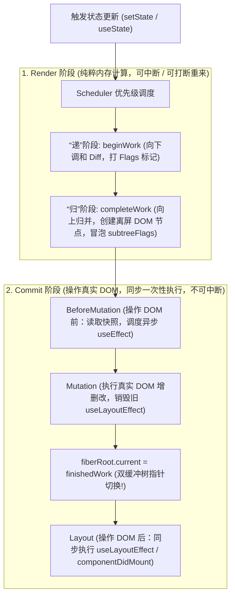

# 现代前端开发岗位高频面试题与权威题解（下篇：React / Vue / 工程化 / 性能优化 / 手写源码）

---

## 目录
- [一、React 核心原理与现代架构（React 18 / 19 深度剖析）](#一react-核心原理与现代架构react-18--19-深度剖析)
  - [Q1: React Fiber 架构深度解析：为什么从 Stack Reconciler 演进为 Fiber？双缓冲树、时间切片（Time Slicing）与 Lane 优先级模型是如何协同工作的？](#q1-react-fiber-架构深度解析为什么从-stack-reconciler-演进为-fiber双缓冲树时间切片time-slicing与-lane-优先级模型是如何协同工作的)
  - [Q2: 详解 React 渲染流水线：Render 阶段（`beginWork` 与 `completeWork`）与 Commit 阶段的三个子阶段（BeforeMutation / Mutation / Layout）分别做了什么？](#q2-详解-react-渲染流水线render-阶段beginwork-与-completework与-commit-阶段的三个子阶段beforemutation--mutation--layout分别做了什么)
  - [Q3: React Hooks 底层原理：为什么不能在条件/循环中调用 Hooks？`useEffect` vs `useLayoutEffect` 的本质区别，以及如何彻底解决 Hooks 的“闭包陷阱（Stale Closure）”？](#q3-react-hooks-底层原理为什么不能在条件循环中调用-hooksuseeffect-vs-uselayouteffect-的本质区别以及如何彻底解决-hooks-的闭包陷阱stale-closure)
  - [Q4: React 18 并发特性（`startTransition`、`useDeferredValue`、`useSyncExternalStore`）与 React 19 核心新特性（Actions、`useOptimistic`、`use` API、React Compiler 自动记忆化原理）](#q4-react-18-并发特性starttransitionusedeferredvalueusesyncexternalstore与-react-19-核心新特性actionsuseoptimisticuse-apireact-compiler-自动记忆化原理)
- [二、Vue 2 vs Vue 3 响应式原理与编译时优化](#二vue-2-vs-vue-3-响应式原理与编译时优化)
  - [Q5: `Object.defineProperty` 与 `Proxy` 的全方位对比：为什么 Vue 3 的 `Proxy` 必须配合 `Reflect` 使用？`ref` 与 `reactive` 的底层实现有何区别？](#q5-objectdefineproperty-与-proxy-的全方位对比为什么-vue-3-的-proxy-必须配合-reflect-使用ref-与-reactive-的底层实现有何区别)
  - [Q6: 详解 Vue 3 响应式依赖收集（Track）与派发更新（Trigger）的底层数据结构（`WeakMap -> Map -> Dep`），以及分支切换 cleanup、嵌套 effect 栈是如何处理的？](#q6-详解-vue-3-响应式依赖收集track与派发更新trigger的底层数据结构weakmap---map---dep以及分支切换-cleanup嵌套-effect-栈是如何处理的)
  - [Q7: 深度对比 React、Vue 2（双端 Diff）、Vue 3（快速 Diff + 最长递增子序列 LIS）的核心 Diff 算法演进，以及为什么绝对不能用数组 `index` 作为 `key`？](#q7-深度对比-reactvue-2双端-diffvue-3快速-diff--最长递增子序列-lis的核心-diff-算法演进以及为什么绝对不能用数组-index-作为-key)
  - [Q8: Vue 3 为什么比 Vue 2 快得多？详解其“编译时优化（Compiler-Informed Virtual DOM）”：PatchFlags、Block Tree（动态节点拍平）、静态提升（hoistStatic）与事件缓存](#q8-vue-3-为什么比-vue-2-快得多详解其编译时优化compiler-informed-virtual-dompatchflagsblock-tree动态节点拍平静态提升hoiststatic与事件缓存)
- [三、现代前端工程化与架构（Webpack / Vite / Monorepo / 微前端）](#三现代前端工程化与架构webpack--vite--monorepo--微前端)
  - [Q9: Webpack 构建全流程解析：Loader（执行顺序与 Pitch 阶段）与 Plugin（Tapable 事件流）的本质区别，以及 HMR（热模块替换）从文件保存至局部刷新的完整底层链路](#q9-webpack-构建全流程解析loader执行顺序与-pitch-阶段与-plugintapable-事件流的本质区别以及-hmr热模块替换从文件保存至局部刷新的完整底层链路)
  - [Q10: 为什么 Vite 在开发环境下比 Webpack 快一个数量级？详解 Esbuild 依赖预构建解决的两大痛点、原生 ESM 按需编译及生产环境为什么仍需 Rollup/Rolldown 打包？](#q10-为什么-vite-在开发环境下比-webpack-快一个数量级详解-esbuild-依赖预构建解决的两大痛点原生-esm-按需编译及生产环境为什么仍需-rolluprolldown-打包)
  - [Q11: Tree Shaking（摇树优化）的底层原理是什么？为什么 CommonJS 难以 Tree Shaking？`sideEffects` 与 `/*#__PURE__*/` 是如何影响构建体积的？](#q11-tree-shaking摇树优化的底层原理是什么为什么-commonjs-难以-tree-shakingsideeffects-与-__pure__-是如何影响构建体积的)
  - [Q12: 微前端架构选型与底层原理：qiankun（HTML Entry + 三种 JS 沙箱 `Snapshot / Legacy / ProxySandbox` + 样式隔离）vs 无界（Wujie WebComponent + iframe）vs Module Federation](#q12-微前端架构选型与底层原理qiankunhtml-entry--三种-js-沙箱-snapshot--legacy--proxysandbox--样式隔离vs-无界wujie-webcomponent--iframevs-module-federation)
- [四、前端性能极致优化与线上监控体系](#四前端性能极致优化与线上监控体系)
  - [Q13: 详解 Google Core Web Vitals 核心性能指标（LCP、INP、CLS、FCP、TTFB）：前端如何通过 `PerformanceObserver` 精确采集并做针对性极致优化？](#q13-详解-google-core-web-vitals-核心性能指标lcpinpclsfcp-ttfb前端如何通过-performanceobserver-精确采集并做针对性极致优化)
  - [Q14: 【架构设计】如何设计一个企业级前端全链路监控 SDK？（错误捕获全覆盖、SourceMap 线上堆栈反解、性能与卡顿帧监测、用户行为面包屑与高可靠上报）](#q14-架构设计如何设计一个企业级前端全链路监控-sdk错误捕获全覆盖sourcemap-线上堆栈反解性能与卡顿帧监测用户行为面包屑与高可靠上报)
  - [Q15: 【场景实战】后端一次性返回 10 万条数据，前端如何实现不卡顿渲染？（深入对比时间分片与定高/不定高动态高度虚拟列表 Virtual List 的完整实现）](#q15-场景实战后端一次性返回-10-万条数据前端如何实现不卡顿渲染深入对比时间分片与定高不定高动态高度虚拟列表-virtual-list-的完整实现)
- [五、前端必考手写代码核心题库（工业级满分源码合集）](#五前端必考手写代码核心题库工业级满分源码合集)
  - [Q16: 手写防抖（Debounce，支持立即执行与取消）与节流（Throttle，时间戳+定时器首尾兼顾版）](#q16-手写防抖debounce支持立即执行与取消与节流throttle时间戳定时器首尾兼顾版)
  - [Q17: 手写工业级深拷贝 `deepClone`（解决 WeakMap 循环引用、Symbol 键、Date、RegExp、Map、Set）](#q17-手写工业级深拷贝-deepclone解决-weakmap-循环引用symbol-键dateregexpmapset)
  - [Q18: 手写 `Promise` 静态并发方法全家桶：`Promise.all`、`Promise.allSettled`、`Promise.race`、`Promise.any`](#q18-手写-promise-静态并发方法全家桶promiseallpromiseallsettledpromiseracepromiseany)
  - [Q19: 手写异步并发控制器 `Scheduler`（限制最大并发数 `maxConcurrency`）与带指数退避的请求自动重试 `retryWithBackoff`](#q19-手写异步并发控制器-scheduler限制最大并发数-maxconcurrency与带指数退避的请求自动重试-retrywithbackoff)
  - [Q20: 手写高频数据结构与函数式编程：`EventEmitter` 发布订阅、基于 `Map` 的 $O(1)$ `LRUCache`、扁平数组转树形结构 `arrayToTree` ($O(n)$)、通用柯里化 `curry` 与 `compose`](#q20-手写高频数据结构与函数式编程eventemitter-发布订阅基于-map-的-o1-lrucache扁平数组转树形结构-arraytotree-on通用柯里化-curry-与-compose)

---

## 一、React 核心原理与现代架构（React 18 / 19 深度剖析）

### Q1: React Fiber 架构深度解析：为什么从 Stack Reconciler 演进为 Fiber？双缓冲树、时间切片（Time Slicing）与 Lane 优先级模型是如何协同工作的？

#### 【考点分析】
React 面试的头号核心必考题，考察对 React 16+ 至今整个底层架构变革（从同步递归栈到可中断异步链表架构）的理解深度。

#### 【标准答案】
1. **React 15 Stack Reconciler 的致命瓶颈**：
   - 在 React 15 中，虚拟 DOM 树是递归树结构，协调过程（Reconciliation）依赖 JS 引擎自身的**函数调用栈（Call Stack）同步递归遍历**。
   - **问题**：一旦组件树庞大（如上千个节点同时更新），递归一旦开始就**无法中途暂停**！如果递归计算耗时 `100ms`，远超浏览器单帧 `16.6ms` 的预算，在此期间主线程被死死占用，用户的点击输入无响应、CSS/rAF 动画卡顿掉帧。

2. **Fiber 的三重身份与三指针链表结构**：
   - **第一重身份（架构层面：把递归调用栈改造成链表迭代循环）**：
     每个 Fiber 节点包含三个核心指针：
     - `child`：指向第一个子 Fiber 节点。
     - `sibling`：指向下一个兄弟 Fiber 节点。
     - `return`：指向父 Fiber 节点（模拟函数执行完毕后返回到的调用方）。
     通过这三大指针，React 将树形递归转化为了 `while (workInProgress !== null && !shouldYield())` 的**可随时暂停、恢复、放弃的线性循环**！
   - **第二重身份（静态数据结构）**：保存组件的类型（`type`/`tag`）、对应的真实 DOM 引用（`stateNode`）、属性（`pendingProps` / `memoizedProps`）、状态链表（`memoizedState`）。
   - **第三重身份（动态工作单元）**：记录本次更新带来的副作用标记（`flags`，如 `Placement`、`Update`、`ChildDeletion`）以及调度优先级（`lanes` / `childLanes`）。

3. **双缓冲树（Double Buffering：`current` vs `workInProgress`）**：
   - React 在内存中同时维护两棵 Fiber 树：
     - **`current` 树**：对应当前屏幕上已经渲染展示的真实 UI。
     - **`workInProgress` 树**：正在后台内存中紧锣密鼓构建的新一代 Fiber 树。两棵树的对应节点通过 **`alternate` 指针**互相指向以复用节点对象。
   - 当 `workInProgress` 树在后台完成所有 Diff 计算并在 Commit 阶段同步更新完真实 DOM 后，根节点 `FiberRootNode.current` 指针直接**一键切换指向 `workInProgress` 树**（瞬间转正为新的 `current` 树），避免了渲染半成品 UI 造成的画面闪烁。

4. **时间切片（Time Slicing）与 Lane 31 位二进制掩码优先级模型**：
   - **为什么 Scheduler 不用 `requestIdleCallback` 而用 `MessageChannel`？**
     1. `requestIdleCallback` 浏览器兼容性不佳（Safari 长期不支持）。
     2. `requestIdleCallback` 触发频率不稳定（仅在浏览器空闲时触发，有时候只有 20fps，且切换标签页时被严重节流）。
     3. React `Scheduler` 利用 **`MessageChannel`** 发起零延迟宏任务，在每帧赋予约 **`5ms`** 的时间切片（`frameInterval = 5ms`）。每处理完一个 Fiber 节点，就调用 `shouldYield()` 检查当前时间片是否用完；若已超过 `5ms` 或检测到高优先级用户输入（`navigator.scheduling.isInputPending`），立即让出主线程给浏览器渲染，并在下一个宏任务中从断点 `workInProgress` 恢复！
   - **Lane 模型（取代早期的 `expirationTime`）**：
     使用 31 位二进制位（bitmask）表示不同赛道的优先级（如 `SyncLane = 0b0001` 离散用户点击输入最高优、`InputContinuousLane` 拖拽滚动、`DefaultLane` 网络请求数据返回、`TransitionLane` 过渡更新、`IdleLane` 最低优）。
     - **优势**：通过极速的位运算（`lanes & SyncLane` 判包含、`lanes |= newLane` 合并批次、`lanes & -lanes` 提取最高优先级赛道），完美支持**高优先级任务插队打断低优先级任务**，而不会像旧版 `expirationTime` 那样把高低优先级混为一谈。

---

### Q2: 详解 React 渲染流水线：Render 阶段（`beginWork` 与 `completeWork`）与 Commit 阶段的三个子阶段（BeforeMutation / Mutation / Layout）分别做了什么？

#### 【考点分析】
考察对 React 源码中两大核心阶段职责边界的精准掌握：为什么 Render 阶段可以中断，而 Commit 阶段绝对不可中断？

#### 【标准答案】


1. **Render 阶段（协调阶段，异步可中断，纯内存操作，无任何真实 DOM 副作用）**：
   采用深度优先遍历（DFS），分为“递”和“归”两个过程：
   - **“递”阶段：`beginWork(current, workInProgress, renderLanes)`**
     1. **性能优化剪枝（Bailout 机制）**：先检查 `oldProps === newProps` 且当前节点没有待更新的 `lanes` 且 `context` 未变。若满足，直接跳过当前组件及其子树的重新渲染，复用旧节点！
     2. **执行组件函数 / render 方法**：若无法跳过，则调用函数组件执行 Hooks 逻辑，拿到最新的 JSX（ReactElement），与 `current.child` 进行 **reconcileChildren（Diff 算法）**，生成子 `workInProgress` Fiber 节点，并打上副作用标记（如 `Placement` 插入、`Update` 更新、`ChildDeletion` 删除）。
   - **“归”阶段：`completeWork(current, workInProgress, renderLanes)`**
     当节点没有子节点时进入“归”阶段（处理完自己后若存在 `sibling` 则转向兄弟节点的 `beginWork`，否则回到父节点的 `completeWork`）：
     1. **Mount 时**：为 HostComponent（原生标签如 `div`）在内存中调用 `document.createElement` 创建离屏真实 DOM 实例（存于 `fiber.stateNode`），并将所有的子 DOM 节点通过 `appendAllChildren` 组装成一棵离屏 DOM 子树，同时初始化 DOM 属性。
     2. **Update 时**：对比新旧 `props`，计算需要更新的属性差异，标记 `Update` flag。
     3. **副作用冒泡（`bubbleProperties`）**：将子节点上的 `flags` 和 `lanes` 向上归并到父节点的 **`subtreeFlags`** 中（React 17 之前是串成一条 `effectList` 单链表，React 18 改为通过判断 `subtreeFlags` 静态属性向下按需遍历，更好地支持并发 Suspense 子树挂起）。

2. **Commit 阶段（提交阶段，同步一口气执行完，绝对不可中断）**：
   - **子阶段 1：`BeforeMutation`（执行 DOM 操作前）**
     - 处理 `getSnapshotBeforeUpdate` 生命周期（读取突变前的 DOM 滚动位置等信息）。
     - **异步调度 `useEffect`**：如果发现存在 `Passive` 标记（即组件使用了 `useEffect`），通过 Scheduler 注册一个异步回调 `flushPassiveEffects`，在浏览器完成绘制后再执行。
   - **子阶段 2：`Mutation`（执行真实 DOM 突变）**
     - 遍历 Fiber 树，根据 `flags` 真正调用 `appendChild`、`insertBefore`、`removeChild`、`setAttribute` 修改页面上的真实 DOM。
     - 调用上一次渲染的 **`useLayoutEffect` 的销毁函数（cleanup）**。
     - **【关键时刻】**：`Mutation` 执行完毕后、进入 `Layout` 阶段前，执行 **`root.current = finishedWork`**，完成双缓冲树的切换！
   - **子阶段 3：`Layout`（真实 DOM 已更新完毕，但浏览器尚未重绘上屏）**
     - **同步执行 `useLayoutEffect` 的回调函数** 和类组件的 `componentDidMount` / `componentDidUpdate`（此时已经可以访问最新的真实 DOM 尺寸，且在此处同步修改样式不会造成视觉闪烁）。
     - 为 `ref` 赋值最新的 DOM 实例引用。

---

### Q3: React Hooks 底层原理：为什么不能在条件/循环中调用 Hooks？`useEffect` vs `useLayoutEffect` 的本质区别，以及如何彻底解决 Hooks 的“闭包陷阱（Stale Closure）”？

#### 【考点分析】
日常 React 开发必考题，考察对 Fiber 节点上 `memoizedState` 单向链表、构建期 `mountWorkInProgressHook` 与更新期 `updateWorkInProgressHook` 游标对齐机制的掌握。

#### 【标准答案】
1. **Hooks 底层数据结构与调用顺序铁律**：
   - 在函数组件对应的 **Fiber 节点**上，有一个属性叫 **`memoizedState`**。在类组件中它是一个对象，而在函数组件中，它指向一条**按 Hooks 调用顺序串联起来的单向链表**！
   - 每个调用的 Hook（如 `useState`、`useEffect`、`useRef`）都会生成一个链表节点：
     ```ts
     type Hook = {
       memoizedState: any; // useState 存 state 值；useEffect 存 effect 对象；useRef 存 { current }；useMemo 存 [val, deps]
       baseState: any;
       baseQueue: Update<any, any> | null;
       queue: UpdateQueue<any, any> | null; // 环状单向链表，存放多次 setState 的更新动作
       next: Hook | null; // 指向函数内下一个调用的 Hook！
     };
     ```
   - **为什么绝不能在 `if / for / early return` 中调用 Hooks？**
     - **Mount 阶段**：每次调用一个 Hook，就新建一个节点追加到 `fiber.memoizedState` 链表末尾（如：`Hook1(useState) -> Hook2(useRef) -> Hook3(useEffect)`）。
     - **Update 阶段**：React **没有任何名字或 key 来标识每个 Hook**，它完全依赖一个全局游标指针 `currentHook = currentHook.next` **严格按照顺序逐个遍历旧链表**来读取上一次的状态！
     - 如果把 `Hook2(useRef)` 放在 `if (flag)` 里，当第二次渲染 `flag` 变为 `false` 时，`Hook2` 没有执行，紧接着执行的 `Hook3(useEffect)` 就会错位去读取原本属于 `Hook2(useRef)` 的 `memoizedState`，导致状态张冠李戴并直接抛出运行时异常 `Rendered fewer hooks than expected`！

2. **`useEffect` 与 `useLayoutEffect` 的本质区别**：

| 维度 | `useEffect` (Passive Effect) | `useLayoutEffect` (Layout Effect) |
| :--- | :--- | :--- |
| **执行时机** | Commit 阶段完成后、**浏览器完成 Layout 和 Paint 上屏之后**，在下一个宏任务/微任务中**异步执行** | Commit 阶段的 **Layout 子阶段**（真实 DOM 已在内存更新，但**浏览器尚未进行绘制 Paint 上屏之前**）**同步执行** |
| **是否阻塞浏览器渲染** | **不阻塞**，用户能更快看到首屏画面 | **阻塞渲染**（如果在里面做重计算，会推迟页面显示） |
| **视觉闪烁问题** | 如果在里面再次读取 DOM 尺寸并触发 `setState` 修改样式，用户会先看到旧位置再跳到新位置（**画面闪烁**） | 在浏览器绘制前同步完成二次修改并合并渲染，**绝不会出现视觉闪烁** |
| **最佳实践** | **99% 的场景首选**（数据请求、事件监听、日志埋点） | 仅用于**需要同步测量 DOM 几何尺寸（如 Tooltip/Popover 定位计算）并立即调整样式**的场景 |

3. **Hooks “闭包陷阱（Stale Closure）”成因与 4 种根治方案**：
   - **成因复现**：函数组件每次渲染都是一次全新的函数调用，拥有独立的词法作用域快照。如果 `useEffect(() => { const id = setInterval(() => console.log(count), 1000) }, [])` 的依赖数组传了空数组 `[]`，定时器回调闭包永远捕获的是**首次渲染（Mount）时的 `count = 0`**，后续每次 `setCount` 生成了新作用域，但旧定时器仍在引用第一帧的 `count`。
   - **根治方案**：
     1. **使用函数式更新 `setState(prev => prev + 1)`**：不依赖外部闭包中的变量，直接从底层队列获取最新状态。
     2. **正确补全依赖数组 `[count]`**：并在 cleanup 函数中清理旧定时器（缺点：每次 `count` 变化都会销毁重建定时器）。
     3. **`useRef` 保存最新引用（稳定引用穿透闭包）**：因为 `useRef` 在整个组件生命周期内返回同一个可变对象 `{ current }`，修改 `ref.current = count` 后，闭包内读取 `ref.current` 永远是最新值。
     4. **使用 React 19.2 原生 `useEffectEvent`（或自定义 `useLatest` / `useMemoizedFn` Hook）**：
        ```tsx
        // 自定义工业级 useMemoizedFn（ahooks 核心实现：既有稳定的函数地址，又能访问最新状态）
        function useMemoizedFn<T extends (...args: any[]) => any>(fn: T): T {
          const fnRef = useRef<T>(fn);
          fnRef.current = useMemo(() => fn, [fn]); // 每次渲染实时更新为最新函数闭包

          const memoizedFn = useRef<T>();
          if (!memoizedFn.current) {
            memoizedFn.current = function (this: any, ...args: any[]) {
              return fnRef.current.apply(this, args);
            } as T;
          }
          return memoizedFn.current;
        }
        ```

---

### Q4: React 18 并发特性（`startTransition`、`useDeferredValue`、`useSyncExternalStore`）与 React 19 核心新特性（Actions、`useOptimistic`、`use` API、React Compiler 自动记忆化原理）

#### 【考点分析】
考察候选人的知识体系是否停留在 React 16/17，还是紧跟 React 18 并发渲染与 React 19 的最新生产范式。

#### 【标准答案】
1. **React 18 三大核心并发 Hook 解析**：
   - **`startTransition` vs `useDeferredValue`（并发非阻塞更新 vs 防抖节流的本质优势）**：
     - **传统防抖/节流缺陷**：防抖必须人为强制延迟（比如等 `300ms`），哪怕用户用的是顶配 M4 Max 电脑、哪怕 `10ms` 就能算完，也必须干等 `300ms`；而节流在重渲染执行的那一刻依然是同步阻塞主线程的。
     - **并发渲染原理**：将状态更新拆分为**紧急更新（Urgent，如输入框光标和文字回显）**与**过渡更新（Transition，如根据输入词过滤渲染 10000 条下拉结果）**。Transition 任务以低优先级 `TransitionLane` 在后台切片渲染，一旦用户继续敲击键盘，立即打断废弃未完成的后台渲染，优先响应最新输入，无需人为设定固定延迟！
     - **两者区别**：`startTransition(fn)` 包装的是**触发状态更新的 `setState` 函数调用**（当你能控制更新源时使用）；`useDeferredValue(value)` 包装的是**一个状态值或父组件传下来的 `props`**（当你拿不到 `setState` 时使用）。
   - **`useSyncExternalStore`（解决并发模式下的状态撕裂 Tearing 问题）**：
     - 在并发时间切片下，如果 Redux / Zustand 等外部状态库不走 React 内部 `useState`，在一次切片渲染中途外部 store 被修改，会导致同一个页面上半部分组件渲染旧值、下半部分组件渲染新值（**视图撕裂 Visual Tearing**）。
     - `useSyncExternalStore(subscribe, getSnapshot)` 会在每次切片渲染前后校验快照是否一致，若发现中途外部 store 被篡改，立即强制降级为同步渲染（`SyncLane`）重新渲染整棵树，确保视图绝对一致。

2. **React 19 五大革命性新特性**：
   - **Actions 与异步过渡（`useTransition` 支持 `async` 函数 + `useActionState` + `useFormStatus`）**：
     不再需要手动维护 `isLoading`、`error` 状态。向 `startTransition(async () => { await submitData() })` 传入异步函数，React 19 自动管理整個异步周期的 `isPending` 状态、错误边界与顺序竞态控制。
   - **原生乐观更新 `useOptimistic`**：
     在发送点赞、发消息等异步请求等待服务端响应期间，先立即在界面上展示假定的成功状态（如消息立即上屏），一旦接口完毕自动同步真实数据，若接口报错则自动无感回滚到请求前的状态！
   - **全新原语 `use(resource)` API**：
     不同于传统 Hooks，**`use()` 可以在 `if` 条件语句和循环中调用**！它可以接收一个 `Promise`（配合 `<Suspense>` 在 Promise resolve 前自动挂起组件）或一个 `Context`（如 `const theme = use(ThemeContext)`）。
   - **告别 `forwardRef` 与 `<Context.Provider>`**：
     在 React 19 中，`ref` 直接作为普通 `props` 传递给函数组件（无需再包裹繁琐的 `React.forwardRef`）；同时可以直接写 `<ThemeContext value="dark">` 代替 `<ThemeContext.Provider>`。
   - **React Compiler（原 React Forget）自动记忆化编译器**：
     在构建期通过 Babel/SWC 插件对组件 AST 进行静态数据流（SSA 静态单赋值形式与依赖分析）转换，在底层自动插入细粒度的缓存槽数组（`useMemoCache` `_c(n)`），自动缓存不变的 JSX 节点、对象与回调函数，让开发者**彻底告别手写心智负担沉重的 `useMemo`、`useCallback` 和 `React.memo`**！

---

## 二、Vue 2 vs Vue 3 响应式原理与编译时优化

### Q5: `Object.defineProperty` 与 `Proxy` 的全方位对比：为什么 Vue 3 的 `Proxy` 必须配合 `Reflect` 使用？`ref` 与 `reactive` 的底层实现有何区别？

#### 【考点分析】
Vue 面试必考题，其中“为什么 `Proxy` 必须搭配 `Reflect`（`Reflect.get(target, key, receiver)` 的第三个参数 `receiver` 究竟解决了什么 bug）”是区分普通开发者与源码级高手的杀手锏问题。

#### 【标准答案】
1. **Vue 2 (`Object.defineProperty`) vs Vue 3 (`Proxy`) 全方位对比**：

| 维度 | Vue 2 (`Object.defineProperty`) | Vue 3 (`Proxy` + `Reflect`) |
| :--- | :--- | :--- |
| **拦截粒度** | 只能劫持对象的**已知特定属性（Property 级）** | 直接代理**整个对象（Object 级）**，支持多达 13 种内部拦截操作 |
| **对象属性动态增删** | **无法监听** `obj.newProp = 1` 或 `delete obj.prop`，必须调用 `Vue.set` / `Vue.delete` | **原生支持**（通过 `set` 和 `deleteProperty` 拦截器，且 `in` 操作符可通过 `has` 拦截，`for...in` 可通过 `ownKeys` 拦截） |
| **数组监听机制** | 无法高效劫持数组索引（`arr[0] = 1` 不响应），只能通过重写数组的 7 个变异方法（`push/pop/shift/unshift/splice/sort/reverse`）实现 | **原生完美支持**数组索引修改与 `length` 变化 |
| **初始化性能（深层嵌套对象）** | 组件初始化时必须**一次性递归遍历所有深层子对象**执行劫持，大对象首屏挂载慢 | **惰性代理（Lazy Reactive）**：只有在真正读取到某个深层对象属性（触发 `get`）时，才按需将其递归包装为 `reactive`，初始化速度极快 |

2. **为什么 Vue 3 的 `Proxy` 必须配合 `Reflect.get(target, key, receiver)` 使用？（核心考点！）**
   看下面这段经典的源码级陷阱案例：
   ```javascript
   const rawObj = {
     _name: 'Vue3',
     get name() {
       // 注意这里的 this！
       return this._name;
     }
   };

   const proxy = new Proxy(rawObj, {
     get(target, key, receiver) {
       track(target, key); // 收集依赖
       // ❌ 错误写法：return target[key];
       // ✅ 正确写法：
       return Reflect.get(target, key, receiver);
     }
   });
   ```
   - **原因剖析**：
     1. 当我们在 `effect(() => console.log(proxy.name))` 中读取访问器属性 `proxy.name` 时，触发了 `Proxy` 的 `get` 拦截器。
     2. 如果我们在拦截器里直接写 **`return target[key]`**，相当于执行了 `rawObj.name`，此时 `get name()` 内部的 **`this` 指向的是原始对象 `rawObj` 而不是代理对象 `proxy`**！
     3. 于是 `this._name` 变成了 `rawObj._name`，直接绕过了 `proxy`，导致 **`_name` 属性根本没有触发 `get` 拦截器，依赖收集彻底失败**！后续修改 `proxy._name = 'React'` 时，视图完全不会更新！
     4. 而使用 **`Reflect.get(target, key, receiver)`**，第三个参数 `receiver` 就是代理对象 `proxy` 本身，它会强制将 `target` 内部 `getter` 函数执行时的 **`this` 绑定为 `receiver`（即 `proxy`）**，从而让 `this._name` 转化为 `proxy._name`，完美触发 `_name` 的依赖收集！

3. **`ref` 与 `reactive` 的底层实现区别**：
   - `Proxy` 规范规定**只能代理引用类型（Object/Array/Map/Set）**，无法直接代理原始值（`number`/`string`/`boolean`）。
   - **`reactive(obj)`**：底层直接调用 `new Proxy(obj, baseHandlers)`（对 `Map`/`Set` 则使用 `collectionHandlers`）。如果直接对 `reactive` 解构（`const { count } = state`），解构出来的是普通原始值，会**丢失响应性**（需配合 `toRefs`）。
   - **`ref(val)`**：底层实例化一个 `RefImpl` 类，通过类原型的 **`get value()` 和 `set value(newVal)` 属性访问器**进行 `trackRefValue` 和 `triggerRefValue`。如果传给 `ref(val)` 的 `val` 是一个对象，`RefImpl` 内部会自动调用 `toReactive(val)`（即 `reactive(val)`）将其转为深层 Proxy 代理。

---

### Q6: 详解 Vue 3 响应式依赖收集（Track）与派发更新（Trigger）的底层数据结构（`WeakMap -> Map -> Dep`），以及分支切换 cleanup、嵌套 effect 栈是如何处理的？

#### 【考点分析】
考察手写简版 `@vue/reactivity` 的核心内功，必须能够画出三层映射图并解释边界场景。

#### 【标准答案】
1. **三层核心依赖存储结构图（`targetMap`）**：
   Vue 3 在全局维护了一个名为 `targetMap` 的 `WeakMap`，其层级关系如下：
   - **第一层 `WeakMap<Target, Map>`**：
     - `key`：被代理的**原始对象 `target`**（为什么必须用 `WeakMap`？因为 `WeakMap` 对键名是**弱引用**，一旦业务组件销毁、原始对象 `target` 不再被任何地方引用时，GC 可以自动将其连同绑定的所有依赖映射一并回收，**绝不产生内存泄漏**！）。
     - `value`：该对象对应的属性映射表 `depsMap`（`Map`）。
   - **第二层 `Map<Key, Dep>`（`depsMap`）**：
     - `key`：对象的具体**属性名 `key`**（如 `'count'`、`'name'`）。
     - `value`：订阅了该属性的所有副作用集合 `dep`（`Set<ReactiveEffect>`，Vue 3.4+ 优化为双向链表结构以降低内存分配开销）。
   - **第三层 `Set<ReactiveEffect>`（`dep`）**：
     - 存放所有读取了 `target[key]` 的 `ReactiveEffect` 实例（包括组件的 `render effect`、`computed`、`watch`）。

2. **两大高阶边界问题与源码级解决方案**：
   - **问题一：分支切换导致的遗留无效依赖（Cleanup 机制）**
     - 场景：`effect(() => { document.body.innerText = state.ok ? state.text : 'fallback' })`。
     - 初始 `state.ok = true`，此时 `state.ok` 和 `state.text` 都收集了这个 `effect`。随后将 `state.ok = false`，页面显示 `'fallback'`。此时按理说无论怎么改 `state.text`，都不应该再触发这个 `effect` 重新执行！但如果旧依赖没清理，修改 `state.text` 依然会触发无意义的更新。
     - **解决**：每个 `ReactiveEffect` 实例自身也维护了一个数组 ` effect.deps = []`（反向记录自己被哪些属性的 `dep` 集合收集了）。每次重新执行 `effect.run()` 之前，先调用 `cleanupEffect(this)` 将自己从所有旧属性的 `Set` 中移除，再在本次执行中重新收集最新走到的分支依赖（*注：Vue 3.2+ 引入了二进制位标记 `trackOpBits` 按位比对新旧依赖，Vue 3.4+ 进一步改为基于递增版本号 `version` 与双向链表清理，性能提升数倍*）。
   - **问题二：组件嵌套 / `effect` 嵌套导致的 `activeEffect` 丢失**
     - 场景：父组件渲染（外层 `effect1`）内部挂载子组件渲染（内层 `effect2`）。如果只用一个全局变量 `activeEffect`，当内层 `effect2` 执行完毕将 `activeEffect = null` 后，回到外层 `effect1` 继续读取的父组件属性就全都收集不到依赖了！
     - **解决**：维护一个调用栈（或通过 `parent` 指针链表）：进入内层 `effect` 前保存 `this.parent = activeEffect; activeEffect = this`，退出内层 `effect` 的 `finally` 块中恢复 `activeEffect = this.parent`。

---

### Q7: 深度对比 React、Vue 2（双端 Diff）、Vue 3（快速 Diff + 最长递增子序列 LIS）的核心 Diff 算法演进，以及为什么绝对不能用数组 `index` 作为 `key`？

#### 【考点分析】
三大框架虚拟 DOM 核心算法的巅峰对决，重点考察同层比较策略、节点复用移动判定及时间复杂度差异。

#### 【标准答案】
1. **Diff 算法的共同前提（将传统树编辑距离 $O(n^3)$ 降维到 $O(n)$ 的三大启发式假设）**：
   - **只做同级比较（Tree Diff）**：绝对不跨层级移动比对。
   - **类型不同直接销毁重建（Component Diff）**：若 `div` 变成 `p` 或组件类型改变，直接卸载整棵旧子树并挂载新子树。
   - **同级列表通过 `key` 唯一标识复用（Element Diff）**。

2. **三大框架多节点列表 Diff 算法深度对比**：

| 框架版本 | 核心算法名称 | 核心比对步骤与移动策略 | 特点与优势 |
| :--- | :--- | :--- | :--- |
| **React** | **两轮遍历 + `lastPlacedIndex` 仅向右移** | 1. **第一轮遍历**：从左往右同步对比新旧子节点，遇到首个 `key` 不同的节点立即中断。<br>2. **第二轮遍历**：将剩余旧节点存入 `Map<key, Fiber>`。遍历剩余新节点，维护一个变量 `lastPlacedIndex`（已复用的旧节点在旧列表中的最大索引）。若当前命中的 `oldIndex < lastPlacedIndex`，则将该真实 DOM **向右移动**；否则更新 `lastPlacedIndex = oldIndex` 不移动。 | 由于 Fiber 是单向链表（无前置指针），无法双端从后往前遍历。**缺陷**：当把最后一个节点移到第一位时（如 `A B C D -> D A B C`），React 会保持 `D` 不动，把 `A`、`B`、`C` 依次移到后面（移动 3 次）。 |
| **Vue 2** | **双端 Diff 算法（四指针向中间收拢）** | 同时维护 `oldStartIdx`、`oldEndIdx`、`newStartIdx`、`newEndIdx` 四个指针，每一轮循环依次尝试 4 种命中（**旧头 vs 新头、旧尾 vs 新尾、旧头 vs 新尾、旧尾 vs 新头**）；若均未命中，则在旧列表中查找新头节点的 `key`。 | 完美解决 `A B C D -> D A B C` 场景（第四步“旧尾 vs 新头”直接命中，仅需将 `D` 移到最前面 1 次！）。 |
| **Vue 3** | **快速 Diff（前置/后置预处理 + 最长递增子序列 LIS）** | 1. **掐头去尾预处理**：借鉴纯文本 Diff，先从头向后同步跳过所有相同的头部节点，再从尾向前同步跳过所有相同的尾部节点。<br>2. **处理纯新增或纯删除**：若旧节点处理完仅剩新节点则批量挂载；反之批量卸载。<br>3. **处理乱序未知序列（核心）**：构建新节点在旧列表中的位置映射数组 `source`，求出 `source` 的**最长递增子序列（Longest Increasing Subsequence, LIS，时间复杂度 $O(n \log n)$）**。处于递增子序列中的节点代表相对顺序完全没变，**原地不动**；仅移动不在递增子序列中的极少数节点！ | 数学意义上的**最少真实 DOM 移动次数**，性能达到 Virtual DOM Diff 的理论极限。 |

3. **为什么绝对不能用数组的索引 `index` 作为 `key`？（两大灾难）**：
   - **灾难一：非受控表单状态错乱 Bug（最严重）**
     假设列表为 `[{id: 'a', name: '张三'}, {id: 'b', name: '李四'}]`，每个列表项内有一个带输入文字的 `<input>`。用 `index` 作 `key` 时，对应的 `key` 是 `0` 和 `1`。当我们在数组**头部插入**一条王五时，新数组中王五的 `index` 变成了 `0`！Diff 算法做前置比对发现新旧第一个节点的 `key` 都是 `0` 且标签都是 `li > input`，于是**直接原地下发复用了原本属于张三的 `<input>` DOM 节点**，导致王五名字后面赫然显示着刚才给张三输入的文字！
   - **灾难二：头部/中间增删时性能彻底退化为全量重渲染**
     头部插入一项后，后面所有 N 个元素的 `index` 全部加 1，导致所有元素的新旧属性对比全部失效，触发 N 次完全不必要的 DOM 文本更新。

---

### Q8: Vue 3 为什么比 Vue 2 快得多？详解其“编译时优化（Compiler-Informed Virtual DOM）”：PatchFlags、Block Tree（动态节点拍平）、静态提升（hoistStatic）与事件缓存

#### 【考点分析】
考察尤雨溪在 Vue 3 中提出的**动静结合（编译时信息指导运行时更新）**的核心设计思想。

#### 【标准答案】
传统虚拟 DOM（包括 Vue 2 和未上 Compiler 的 React）在更新时是“盲目”的：假设一个模板里有 100 个 HTML 节点，其中 99 个是写死的纯静态标签，只有 1 个 `<span>{{ count }}</span>` 是动态的，传统 VDOM 依然不得不完整遍历比对这 100 个节点及其所有属性。Vue 3 通过模板编译器（`@vue/compiler-sfc`）在编译阶段静态分析模板，做了四大极致优化：

1. **靶向更新（PatchFlags 补丁标记）**：
   - 编译器在编译生成 `createElementVNode` 时，如果发现节点带有动态绑定，会在第 4 个参数打上**二进制位标记 `PatchFlag`**：
     - `1 /* TEXT */`：仅动态文本内容变化。
     - `2 /* CLASS */`：仅动态 `class` 变化。
     - `4 /* STYLE */`：仅动态 `style` 变化。
     - `8 /* PROPS */`：除了 class/style 以外的动态属性变化（并附带具体变化的属性名数组 `['id', 'title']`）。
   - **效果**：运行时 Diff 该节点时，不用再去全量遍历比对 `props` 对象，直接通过位运算 `if (patchFlag & PatchFlags.TEXT)` **精准定位只更新 `el.textContent`**！

2. **Block Tree 与 `dynamicChildren`（将树形全量遍历拍平为动态节点一维数组遍历！）**：
   - 编译器会将模板根节点以及所有带有 `v-if` / `v-for` 结构化指令的节点标记为一个 **Block（块）**。
   - 每个 Block 节点在创建时，不仅有常规的 `children` 树，还会额外收集其内部所有后代中带有 `PatchFlag` 的动态节点，存入一个**一维扁平数组 `dynamicChildren`**！
   - **效果**：当组件状态更新时，Vue 3 **完全跳过 `children` 树的递归遍历**，而是直接遍历 `block.dynamicChildren` 数组！使得 Diff 性能**不再与整个模板的 DOM 总大小挂钩，而是仅仅与动态绑定的数量成正比**！

3. **静态提升（`hoistStatic`）与预字符串化（Pre-stringification）**：
   - 对于完全没有任何动态绑定的纯静态节点（如 `<div class="icon">静态文案</div>`），编译器直接将其 `createVNode` 调用**提升到 `render` 函数外部顶层**。这意味它们只在应用启动时创建一次，之后每次组件重渲染直接复用同一个 VNode 引用，连创建 VNode 对象的内存开销都省了。
   - 当连续静态节点超过阈值（如 20 个），编译器甚至会直接把它们合并编译成一整段静态 HTML 字符串 `createStaticVNode("<div>...</div>")`，直接通过 `innerHTML` 一次性挂载。

4. **内联事件处理函数缓存（`cacheHandlers`）**：
   - 对于 `<Comp @click="() => count++" />`，默认每次 `render` 都会生成一个全新的箭头函数引用，导致子组件 `Comp` 误以为 `props.onClick` 变了而触发无谓的子组件重渲染。开启 `cacheHandlers` 后，编译器会自动将内联函数缓存在 `_cache[0]` 中，永远保持引用稳定（相当于自动帮你包了一层 `useCallback`）。

---

## 三、现代前端工程化与架构（Webpack / Vite / Monorepo / 微前端）

### Q9: Webpack 构建全流程解析：Loader（执行顺序与 Pitch 阶段）与 Plugin（Tapable 事件流）的本质区别，以及 HMR（热模块替换）从文件保存至局部刷新的完整底层链路

#### 【考点分析】
前端工程化基石题，考察对打包器内核架构、Loader 管道模型及 HMR WebSocket + JSONP 双通道机制的理解。

#### 【标准答案】
1. **Webpack 核心构建生命周期**：
   1. **初始化阶段（Initialize）**：合并 CLI 参数与 `webpack.config.js`，创建全局唯一的 **`Compiler`** 实例，遍历注册所有配置的 `Plugins`（调用 `plugin.apply(compiler)` 挂载生命周期钩子）。
   2. **编译阶段（Compile & Make）**：调用 `compiler.run()`，每次构建创建一个 **`Compilation`** 实例（代表一次具体的模块图构建）。从 `entry` 入口文件出发，调用匹配的 **`Loaders`** 将非 JS 资源转译为标准 JS，再用 `acorn` 解析为 **AST 抽象语法树**，静态收集所有的 `import / require` 依赖路径，递归构建完整的 **Module Dependency Graph（模块依赖图）**。
   3. **封包优化阶段（Seal）**：根据入口和动态导入 `import()` 将模块划分为多个 **`Chunk`**，执行 Tree Shaking 标记、SplitChunks 代码分割、Terser 代码压缩，并将模块源码中的 `import` 替换为 `__webpack_require__` 运行时代码。
   4. **输出阶段（Emit）**：触发 `compiler.hooks.emit`（插件修改最终产物内容的最后机会），根据 `output` 配置将文件内容写入磁盘 `dist` 目录。

2. **Loader 与 Plugin 的本质区别及 Loader 执行顺序秘密**：
   - **Loader（文件转换器）**：因为 Webpack 原生只认识 JS 和 JSON，Loader 本质上是一个**纯函数 `(source: string | Buffer) => string`**，在加载单个模块时将 Sass、TS、Vue SFC 等转译为 JS 模块。
   - **Plugin（生命周期扩展器）**：基于 **`Tapable` 发布-订阅事件流框架**（含 `SyncHook`、`AsyncSeriesHook`、`AsyncParallelHook` 等），是一个包含 `apply(compiler)` 方法的类，可以介入 Webpack 编译的整个生命周期（如打包体积分析、提取独立 CSS 文件 `MiniCssExtractPlugin`、生成 HTML `HtmlWebpackPlugin`）。
   - **为什么 `use: ['style-loader', 'css-loader', 'sass-loader']` 是从右往左执行的？什么是 Pitch 阶段？**
     - 实际上 Loader 的完整执行分为两个阶段（类似 DOM 事件的捕获与冒泡）：
       1. **Pitch 阶段（从左往右）**：依次执行 `style-loader.pitch` $\to$ `css-loader.pitch` $\to$ `sass-loader.pitch`。**如果某个 Loader 的 `pitch` 方法返回了非 `undefined` 的值（熔断机制），就会直接跳过后面所有的 Loader，掉头执行左边 Loader 的 normal 阶段！**（`style-loader` 正是利用 `pitch` 阶段返回了一段内联请求脚本）。
       2. **Normal 阶段（读取源文件后，从右往左 / 从下往上）**：属于函数组合 `compose(styleLoader, cssLoader, sassLoader)(rawSource)`，先由 `sass-loader` 把 SCSS 编译为 CSS，再交给 `css-loader` 解析 `@import` 和 `url()`，最后交给 `style-loader` 动态创建 `<style>` 标签插入 DOM。

3. **HMR（Hot Module Replacement 热模块替换）完整 6 步底层链路**：
   1. **文件监听与增量编译**：开发者在编辑器保存代码，`webpack-dev-server` (WDS) 内部的 `chokidar` 监听到文件变更，触发增量编译，并将编译产物保存在**内存文件系统（`memfs`）**中（不写磁盘，所以快）。
   2. **生成两份热更新补丁文件**：编译完成后，生成携带上次编译 `Hash` 的两个文件：
      - **`[hash].hot-update.json`（Manifest 清单）**：告知哪些 Chunk 发生了改变以及最新的编译 Hash。
      - **`[chunkId].[hash].hot-update.js`（更新模块代码）**：通过 JSONP 格式包裹的、仅包含被修改模块最新代码的补丁包。
   3. **WebSocket 推送通知**：WDS 通过与浏览器客户端建立的 **WebSocket 长连接**，向浏览器发送两条消息：`type: "hash"`（最新哈希值）和 `type: "ok"`（通知客户端可以开始热更新了）。
   4. **客户端请求补丁（AJAX + JSONP）**：浏览器端的 `HMR Runtime` 收到 `"ok"` 后，先用 `fetch/AJAX` 请求 `[lastHash].hot-update.json` 获取变更的 Chunk 列表，随后动态创建 `<script>` 标签通过 **JSONP** 拉取对应的 `[chunkId].[lastHash].hot-update.js`。
   5. **替换模块缓存与冒泡检查**：`HMR Runtime` 收到新模块代码后，找出旧模块及其父级依赖链，检查是否注册了 `module.hot.accept` 回调（日常开发中无需我们手写，因为 **`vue-loader`、`react-refresh`、`style-loader` 已经在编译时自动为我们注入了 `module.hot.accept` 代码**！）。
   6. **局部视图更新 / 降级整页刷新**：调用对应的热替换处理函数（如 `react-refresh` 保留组件 State 重新渲染更新的组件函数）；若整条冒泡链直到入口文件都没有人 `accept` 该模块或更新报错，则自动降级执行 `window.location.reload()` 刷新整个页面。

---

### Q10: 为什么 Vite 在开发环境下比 Webpack 快一个数量级？详解 Esbuild 依赖预构建解决的两大痛点、原生 ESM 按需编译及生产环境为什么仍需 Rollup/Rolldown 打包？

#### 【考点分析】
现代前端构建工具必考对比题，考察对 Bundle-based（打包后启动）与 Native ESM Unbundled（免打包按需编译）两种架构范式的深刻理解。

#### 【标准答案】
1. **核心架构差异：Bundle-based (Webpack) vs Native ESM (Vite)**：
   - **Webpack（先全量打包，再启动服务）**：冷启动时必须从入口出发，递归爬取、转译、打包项目里成千上万个模块生成完整的 Bundle 后，开发服务器才能就绪。项目越大，启动越慢（动辄几十秒到几分钟）。
   - **Vite（先瞬间启动服务器，浏览器请求哪个模块再按需编译哪个模块）**：
     利用现代浏览器原生支持 `<script type="module">` 的特性，Vite 启动时**根本不打包业务源码**！直接毫秒级启动一个 HTTP Server。当浏览器解析到 `import App from './App.vue'` 时，会向 Vite Dev Server 发起一个 HTTP 请求，Vite 此时才利用中间件实时将 `App.vue` 编译成标准 ESM 返回给浏览器。这意味着**无论项目有 10 个页面还是 1000 个页面，冷启动永远只需几百毫秒，且只编译当前打开的路由页面用到的模块**！

2. **既然浏览器原生支持 ESM，为什么 Vite 还要用 `Esbuild` 做一次“依赖预构建（Dependency Pre-Bundling）”？（解决两大致命痛点）**：
   首次启动时，Vite 会用 Go 语言编写的 **Esbuild**（基于多线程并行与机器码，比 JS 编写的打包器快 10~100 倍）扫描 `node_modules` 中的第三方依赖并打包到 `node_modules/.vite/deps` 下，原因有二：
   - **痛点一：模块格式兼容（CommonJS / UMD 转 ESM）**：
     浏览器原生 `<script type="module">` **只认 ES Module (`import/export`)**，完全不认识 CommonJS (`require/module.exports`)。而 npm 生态中有大量老牌库（包括 `react`、`lodash` 等）发布的是 CommonJS 格式，必须通过 Esbuild 预构建统一转译为标准 ESM。
   - **痛点二：消除“海量小模块 HTTP 请求瀑布流（Network Waterfall）”**：
     以 `lodash-es` 为例，虽然它是 ESM 格式，但它内部拆成了 **600 多个独立的小 JS 文件**！当你写下一行 `import { debounce } from 'lodash-es'` 时，如果不做预构建，浏览器会瞬间发出 600 多个并发 HTTP 请求，直接把浏览器网络线程堵死数秒！Esbuild 预构建会将 `lodash-es` 的 600 多个小文件**合并打包成唯一一个单文件 ESM 模块**，只需 1 次 HTTP 请求，且赋予 `Cache-Control: max-age=31536000, immutable` 强缓存。

3. **为什么 Vite 生产环境（`vite build`）不直接用原生 ESM 上线，而是依然要用 Rollup（及最新基于 Rust 的 Rolldown）打包？**
   - 在公网生产环境下，未打包的源码存在多层嵌套 `import`，每一次嵌套都会产生一个公网网络往返（RTT 延迟），瀑布流延迟极高。
   - 生产环境需要极致的 **Tree Shaking、作用域提升（Scope Hoisting）、CSS 提取与压缩、细粒度代码分割（Manual Chunks）以及动态导入 Polyfill**，Rollup（以及 Vite 团队用 Rust 打造的下一代高性能统一打包引擎 **Rolldown**）在这些生产级静态分析与产物优化上更加成熟完善。

---

### Q11: Tree Shaking（摇树优化）的底层原理是什么？为什么 CommonJS 难以 Tree Shaking？`sideEffects` 与 `/*#__PURE__*/` 是如何影响构建体积的？

#### 【考点分析】
考察打包体积优化的核心内功，很多工程发现引入了组件库却把全量代码打包了进去，根源就在这里。

#### 【标准答案】
1. **Tree Shaking（死代码消除 Dead Code Elimination）的前提与原理**：
   - **核心基石：ES Module 的静态结构特性**。
     - **CommonJS 是运行时动态加载**：允许写 `const lib = require(isProd ? './a' : './b')` 或 `module.exports[dynamicKey] = fn`。在代码真正运行前，静态编译器根本无法确定到底导出了什么、引用了什么。
     - **ES Module 是编译时静态分析**：规范强制规定 `import` 和 `export` **只能出现在模块顶层作用域**，不能写在 `if` 语句里，且导入路径必须是静态字符串字面量。因此打包器在构建 AST 阶段就能 100% 确定模块间的导出与引用拓扑关系。
   - **两步实现过程（以 Webpack 为例）**：
     1. **标记阶段（Flagging）**：编译期分析哪些 `export` 变量没有被任何其他模块引用，在生成的模块头部通过 `/* unused harmony export xxx */` 进行标记（开启 `optimization.usedExports: true`）。
     2. **清除阶段（Minification）**：交给代码压缩工具（如 **Terser / Esbuild / SWC**），在生成最终产物时将未被使用的导出函数与死分支物理删除。

2. **为什么有时候写了 ESM 依然无法被 Tree Shaking 掉？（函数副作用 Side Effects 与两大解决方案）**：
   - **难题：副作用（Side Effects）无法静态判定**：
     比如一个模块顶层写了 `export const a = createInstance()` 或者在文件里执行了 `Array.prototype.customMethod = ...`（Polyfill）或引入了全局 CSS。打包器不知道调用 `createInstance()` 的内部是否修改了全局变量 `window.xxx`，为了安全起见（防止删掉代码导致程序运行异常），**默认不敢删掉顶层函数调用和整个被 import 但未使用的文件**！
   - **解决方案一：在 `package.json` 中配置 `"sideEffects"`（文件级豁免）**：
     - `"sideEffects": false`：向打包器郑重承诺——本包内所有文件都没有模块顶层副作用，只要某个文件导出的变量没被用到，可以直接把整个文件彻底跳过不打包！
     - `"sideEffects": ["*.css", "*.less", "./src/polyfills.js"]`：**工程必配**！声明除了样式文件和 polyfill 外，其余文件均可安全摇树（若忘了把 `*.css` 放进数组，会导致 `import './style.css'` 被当成无引用的死代码直接删掉，引发线上样式丢失事故！）。
   - **解决方案二：使用 `/*#__PURE__*/` 注释标记（表达式级豁免）**：
     在组件库编译源码中（如 `export const Button = /*#__PURE__*/ forwardRef(...)`），在函数调用前加上 `/*#__PURE__*/`，明确告知 Terser/Rollup：“这个函数调用是纯函数，完全没有副作用，如果返回值 `Button` 没有被外部使用，请放心地把整行调用删掉！”

---

### Q12: 微前端架构选型与底层原理：qiankun（HTML Entry + 三种 JS 沙箱 `Snapshot / Legacy / ProxySandbox` + 样式隔离）vs 无界（Wujie WebComponent + iframe）vs Module Federation

#### 【考点分析】
中大型企业级中后台架构必考题，重点考察不同微前端框架如何解决**资源加载、JS 全局变量污染隔离（沙箱）、CSS 样式冲突隔离、应用间通信**四大核心命题。

#### 【标准答案】
1. **qiankun（基于 single-spa 的微前端方案）三大核心原理**：
   - **1. 资源加载机制（`import-html-entry`）**：
     放弃了 single-spa 原始繁琐的 JS Entry，改为直接请求子应用的 `index.html`，通过正则解析提取出所有的 `<link>`、`<style>`（转为内联样式）和 `<script>` 脚本代码，在主应用容器内动态执行并接管子应用的 `bootstrap / mount / unmount` 生命周期。
   - **2. JS 沙箱隔离机制（防止子应用污染全局 `window` 对象）**：
     - **`SnapshotSandbox`（快照沙箱，降级兼容不支持 Proxy 的老浏览器，仅支持单实例）**：
       - **激活（mount）时**：遍历 `window` 上的所有属性存为快照 `windowSnapshot`，并将上次卸载时记录的修改差值 `modifyPropsMap` 还原到 `window` 上。
       - **卸载（unmount）时**：再次遍历 `window` 与快照对比，将子应用运行期间修改过的属性记录到 `modifyPropsMap`，并把 `window` 恢复成快照原样。
     - **`LegacySandbox`（基于 Proxy 的单实例沙箱）**：
       利用 `Proxy` 监听对 `window` 的修改，维护三个 Map：`addedPropsMap`（新增属性）、`modifiedPropsOriginalValueMap`（修改属性的原始值）、`currentUpdatedPropsValueMap`（所有变更的新值）。无需在激活/卸载时全量遍历整个 `window`，性能优于快照沙箱，但因直接操作真实 `window` 仍不支持多子应用同屏激活。
     - **`ProxySandbox`（基于 Proxy + `fakeWindow` 的多实例沙箱，默认主力方案）**：
       为每个子应用创建一个全新的空对象 `fakeWindow = Object.create(null)`，用 `Proxy` 代理它。然后把子应用的 JS 代码包裹在 **`with(window) { ... }`** 块中并传入这个 `proxy` 作为 `window`：
       - **写入（`set`）**：所有 `window.a = 1` 全部写在子应用私有的 `fakeWindow` 上，**完全不碰真实 `window`**！
       - **读取（`get`）**：优先从私有的 `fakeWindow` 读，读不到再兜底去真实的 `rawWindow` 上读（并对 `window.addEventListener`、`setInterval` 做拦截记录，在子应用卸载时自动清理残留监听器和定时器！）。
   - **3. CSS 样式隔离机制**：
     - `strictStyleIsolation: true`：将子应用根节点包裹在原生 **`Shadow DOM`（`attachShadow({ mode: 'open' })`）** 中。优点是完全物理隔离；**致命缺点**：React 16 事件委托在 `document` 上，以及 Ant Design / Element Plus 等组件库的 `Modal / Dropdown / Tooltip` 默认挂载在 `document.body` 上，跳出了 Shadow DOM，导致弹窗样式全部丢失！
     - `experimentalStyleIsolation: true`：类似 Vue 的 `scoped CSS`，在运行时动态改写子应用所有 CSS 选择器，加上属性前缀 `div[data-qiankun="subApp1"] .btn { ... }`。

2. **三大主流微前端方案选型对比**：

| 维度 | qiankun | Wujie（腾讯无界） | Webpack 5 Module Federation（模块联邦） |
| :--- | :--- | :--- | :--- |
| **底层核心原理** | `import-html-entry` + `with(Proxy)` 沙箱 | **將子应用的 JS 放入同域空白 `iframe` 中运行**（天然最完美的浏览器原生 JS 沙箱），**将子应用的 DOM 渲染到主应用的 `WebComponent (Shadow DOM)` 中**，通过劫持 iframe 的 `document` 操作代理到 ShadowRoot | 构建时配置 `remotes` 与 `exposes`，在运行时跨应用动态按需加载远程构建好的组件/模块 Chunk，并支持共享依赖（`shared: ['react']`） |
| **JS / CSS 隔离彻底性** | 存在 `with` 性能损耗及 `document.body` 弹窗逃逸问题 | **极佳**（原生 iframe 隔离 JS，且无界底层已自动拦截修补了弹窗挂载到 body 的越界问题） | 无内置沙箱，需团队自行约定规范（因为它本质是跨应用代码共享而非全量沙箱容器） |
| **子应用接入改造成本** | 中等（需导出 3 个生命周期钩子并修改 `publicPath`） | **极低（几乎零改造，开箱即用，天然支持 Vite 子应用！）** | 低（仅需修改构建配置，适合组件级/模块级跨项目复用） |

---

## 四、前端性能极致优化与线上监控体系

### Q13: 详解 Google Core Web Vitals 核心性能指标（LCP、INP、CLS、FCP、TTFB）：前端如何通过 `PerformanceObserver` 精确采集并做针对性极致优化？

#### 【考点分析】
衡量前端性能工程化水平的标准标尺。注意：**Google 已正式使用 INP（Interaction to Next Paint）全面取代了旧指标 FID（First Input Delay）**，回答出 INP 会让面试官眼前一亮！

#### 【标准答案】
1. **五大核心性能指标定义与优秀阈值**：

| 指标缩写 | 全称与含义 | 优秀标准 (Good) | 核心反映的用户体验维度 |
| :--- | :--- | :--- | :--- |
| **TTFB** | Time to First Byte（首字节时间） | `< 800ms` | DNS + TCP/TLS + 服务端处理耗时 + CDN 命中率 |
| **FCP** | First Contentful Paint（首次内容绘制，首个文本/图片像素上屏） | `< 1.8s` | 用户感知“页面开始加载出来，不再是白屏” |
| **LCP** | **Largest Contentful Paint（最大内容绘制，视口内最大图片或文本块渲染完成）** | **`< 2.5s`** | **核心加载指标**：用户感知“主屏核心内容已加载完毕” |
| **INP** | **Interaction to Next Paint（交互到下一帧绘制耗时，取代旧版 FID）** | **`< 200ms`** | **核心交互响应指标**：统计页面整个生命周期内所有点击/按键交互从触发到下一帧画面更新的 P98 延迟（FID 只测第一次交互的排队时间，而 INP 测量全周期的 `输入延迟 + 事件处理耗时 + 下一帧渲染耗时` 全链路！） |
| **CLS** | **Cumulative Layout Shift（累积布局偏移）** | **`< 0.1`** | **核心视觉稳定性指标**：防止用户刚要点按钮，上方图片突然加载出来把按钮顶下去导致误触 |

2. **前端通过原生 `PerformanceObserver` 采集核心指标源码**：
   ```javascript
   // 1. 采集 LCP（注意：随着页面加载，最大元素可能不断变化，需取最后一条记录）
   new PerformanceObserver((entryList) => {
     const entries = entryList.getEntries();
     const lastEntry = entries[entries.length - 1];
     console.log('LCP:', lastEntry.startTime, 'Element:', lastEntry.element);
   }).observe({ type: 'largest-contentful-paint', buffered: true });

   // 2. 采集 CLS（排除用户主动点击后 500ms 内触发的合理布局变化 hadRecentInput）
   let clsValue = 0;
   new PerformanceObserver((entryList) => {
     for (const entry of entryList.getEntries()) {
       if (!entry.hadRecentInput) {
         clsValue += entry.value;
       }
     }
     console.log('Current CLS:', clsValue);
   }).observe({ type: 'layout-shift', buffered: true });
   ```

3. **针对性极致优化实战方案**：
   - **LCP 优化四板斧**：
     1. **优化首屏关键资源发现优先级**：对首屏 Banner 大图显式加上 **``**，且**严禁对首屏可视区内的图片使用 `loading="lazy"`（懒加载会严重推迟 LCP！）**；对 CSS 背景中的关键大图在 `<head>` 中加入 `<link rel="preload" as="image" href="hero.webp">`。
     2. **现代图片格式与响应式裁剪**：全量升级 **AVIF / WebP** 格式（比 PNG/JPEG 小 50%+），配合 CDN 动态尺寸参数与 `srcset`。
     3. **架构升级**：SSR（服务端渲染 Next.js / Nuxt）或 SSG / 流式 Streaming SSR + CDN 边缘缓存，消除客户端 CSR 串行请求瀑布流。
     4. **路由级与组件级按需加载**：`React.lazy` / `defineAsyncComponent` 拆分巨型 `vendor.js`，开启 Brotli (`br`) 静态资源压缩（比 Gzip 再小 15%~20%）。
   - **INP 优化（解决主线程长任务 Long Tasks > 50ms）**：
     1. 拆分长任务：在耗时循环中主动通过 `await scheduler.yield()` 或 `setTimeout` 让出主线程，让浏览器先完成点击态 UI 反馈绘制。
     2. 将密集型计算（大表格导出解析、加密哈希、复杂数据聚合）剥离到 **Web Worker** 后台线程。
   - **CLS 归零方案**：
     1. 所有 `` 和 `<video>` 标签**必须显式设置 `width` 和 `height` 属性，或设置 CSS `aspect-ratio: 16 / 9`**，让浏览器在图片下载完成前提前预留好精确的占位空间。
     2. 异步插入的广告位、通知横幅预留固定最小高度 `min-height` 或使用骨架屏（Skeleton）。
     3. 字体加载设置 `font-display: optional` 或配合 `size-adjust` 消除字体替换引发的排版跳动（FOUT）。

---

### Q14: 【架构设计】如何设计一个企业级前端全链路监控 SDK？（错误捕获全覆盖、SourceMap 线上堆栈反解、性能与卡顿帧监测、用户行为面包屑与高可靠上报）

#### 【考点分析】
考察资深/架构级前端的全局设计视野，需从**数据采集层、预处理与上下文组装层、传输上报层、服务端清洗与报警层**完整阐述。

#### 【标准答案】
1. **全景异常捕获矩阵（5 类错误无死角拦截）**：

| 错误类型 | 监听/拦截方式 | 核心注意事项 |
| :--- | :--- | :--- |
| **1. JS 运行时同步/异步定时器错误** | `window.addEventListener('error', handler)` 或 `window.onerror` | 若加载跨域 CDN 脚本报错只会拿到毫无意义的 `"Script error."`，需给 `<script crossorigin="anonymous">` 且 CDN 响应头配 `Access-Control-Allow-Origin` |
| **2. 静态资源加载失败（`img`/`script`/`link`）** | `window.addEventListener('error', handler, true)`（**第三个参数必须设为 `true` 开启捕获阶段**！） | 因为资源加载失败事件**不会冒泡**，必须在捕获阶段拦截，并通过 `event.target !== window && (event.target.src \|\| event.target.href)` 与普通 JS 错误区分 |
| **3. 未捕获的 Promise Rejection** | `window.addEventListener('unhandledrejection', e => ...)` | 提取 `e.reason` 获取错误堆栈 |
| **4. 框架组件渲染异常** | React: `ErrorBoundary` (`componentDidCatch` / `getDerivedStateFromError`)<br>Vue: `app.config.errorHandler = (err, instance, info) => ...` | Vue/React 内部会 `try...catch` 组件生命周期错误，若不配置框架级钩子不会冒泡到全局 `window.onerror`（React 19 新增 `createRoot(el, { onCaughtError, onUncaughtError })`） |
| **5. 接口请求异常（XHR / Fetch）** | AOP 切片重写 `XMLHttpRequest.prototype.open/send` 与 `window.fetch` | 捕获 HTTP `4xx / 5xx`、网络超时与接口耗时，**注意必须排除监控上报接口自身的 URL，防止上报失败引发死循环无限上报！** |

2. **用户行为回溯面包屑（Breadcrumbs）与 SourceMap 安全反解**：
   - **行为栈（Breadcrumbs）**：维护一个固定容量（如长度为 20）的循环队列，通过事件代理自动记录报错前用户的最近 20 步操作轨迹（如：`点击了[提交订单按钮] -> 路由跳转[/checkout] -> 发起请求[POST /api/pay 500] -> 抛出 TypeError`），随错误日志一并上报，瞬间复现案发现场。
   - **生产环境 SourceMap 安全反解**：
     - 生产构建开启 `devtool: 'hidden-source-map'`（生成 `.map` 文件，但不在打包出的 `.js` 末尾写入 `//# sourceMappingURL=` 注释，防止源码暴露给外网黑客）。
     - 在 CI/CD 流水线中，将 `.map` 文件连同本次发布的 `release version` 上传至内网监控平台，随后从待部署产物中删除 `.map`。
     - 线上报错只上报压缩后的 `文件名 + line + column`，监控后台利用 `source-map` 库 (`SourceMapConsumer.originalPositionFor({ line, column })`) 自动还原出精确的 TypeScript/Vue 源代码文件名、行号及上下文代码片段。

3. **高可靠、零侵入的数据上报策略**：
   - **优先使用 `navigator.sendBeacon(url, blob)`**：
     传统 `XHR/fetch` 在用户关闭标签页或跳转页面（`unload / visibilitychange: hidden`）时会被浏览器直接强行取消导致最后一条关键崩溃日志丢失；而 `sendBeacon` 由浏览器底层网络进程接管，**即使页面已经彻底关闭，依然保证在后台异步可靠发送成功，且绝不阻塞页面卸载和下一跳导航**！
   - **批量缓冲与削峰降级**：普通性能与行为日志先写入内存队列（并同步落盘一份到 `localStorage/IndexedDB` 防崩溃丢失），利用 `requestIdleCallback` 在浏览器空闲时批量打包发送，或达到 10 条 / 每隔 5 秒定时刷盘；针对 PV 过亿的站点支持按比例抽样（Sampling）与同一错误客户端去重限流。

---

### Q15: 【场景实战】后端一次性返回 10 万条数据，前端如何实现不卡顿渲染？（深入对比时间分片与定高/不定高动态高度虚拟列表 Virtual List 的完整实现）

#### 【考点分析】
性能优化必考场景题，面试官通常会追问：“如果只用 `requestAnimationFrame` 分片插入 10 万个 DOM 节点，会有什么问题？不定高（动态高度，比如文字长短不一、带图片展开收起）的虚拟列表应该怎么实现？”

#### 【标准答案】
1. **方案演进对比**：
   - **初级方案：时间分片（Time Slicing，`requestAnimationFrame` + `DocumentFragment`）**
     - 每次 `rAF` 帧只创建 100 个 DOM 节点放入 `DocumentFragment` 追加到页面，分 1000 帧完成。
     - **致命缺陷**：虽然插入过程不卡，但最终页面上实打实存在 **10 万个真实 DOM 节点**！此时内存占用飙升数百 MB，任何一次滚动或窗口缩放引起的重排重绘都会卡成幻灯片。因此**超过 1000 条的列表，唯一正解是虚拟列表（Virtual Scrolling）**！

2. **定高虚拟列表（Fixed-Height Virtual List）核心数学模型**：
   无论数据有 10 万条还是 100 万条，视口（Viewport）同一时刻能看到的只有约 10~20 条，因此**真实挂载在 DOM 树上的永远只有可视区及上下缓冲区的约 20 个 DOM 节点**！
   - **三层 DOM 结构**：
     1. 外层固定高度可滚动视口容器：`viewport`（`height: 600px; overflow-y: auto; position: relative`）。
     2. 内部撑开总滚动条高度的幽灵占位层：`phantom`（`height: totalCount * itemHeight px`）。
     3. 实际渲染列表项的绝对定位内容层：`content`（通过 **`transform: translate3d(0, offsetY, 0)`** 随滚动实时向下平移到当前可视区位置！）。
   - **滚动时 (`onScroll`) 的 4 个核心计算公式**：
     - 起始索引：$\text{startIndex} = \lfloor \text{scrollTop} \div \text{itemHeight} \rfloor$
     - 可视区容纳条数：$\text{visibleCount} = \lceil \text{viewportHeight} \div \text{itemHeight} \rceil$
     - 结束索引（加上下 Buffer 缓冲区防快速滚动白屏）：$\text{endIndex} = \text{startIndex} + \text{visibleCount} + \text{bufferCount}$
     - 偏移量：$\text{offsetY} = \text{startIndex} \times \text{itemHeight}$

3. **进阶难点：不定高（动态高度）虚拟列表的工业级实现方案**：
   当每条数据的高度未知（如微博信息流、AI 聊天记录）时，无法直接用 `scrollTop / itemHeight` 除法求 `startIndex`，标准解法如下：
   1. **第 1 步（预估高度初始化 `positions` 缓存数组）**：
      先设定一个预估高度 `estimatedItemHeight = 80px`，初始化一个长度为 $N$ 的位置元数据数组 `positions`：
      `positions[i] = { index: i, height: 80, top: i * 80, bottom: (i + 1) * 80 }`。
   2. **第 2 步（二分查找 $O(\log n)$ 计算 `startIndex`）**：
      因为 `positions[i].bottom` 是严格单调递增的，当触发 `scroll` 得到 `scrollTop` 时，使用**二分查找（Binary Search）**在 `positions` 数组中找到第一个 `bottom > scrollTop` 的元素，其下标即为 `startIndex`！
   3. **第 3 步（渲染后真实 DOM 高度测量与差值修正 `ResizeObserver`）**：
      当可视区的 20 个节点挂载到真实 DOM 后（在 `useLayoutEffect` / `onUpdated` 或通过 **`ResizeObserver`** 监听每个列表项尺寸变化），读取每个节点的 `el.getBoundingClientRect().height` 真实高度。
      如果发现 `realHeight !== positions[i].height`，计算出高度差 $\Delta = \text{realHeight} - \text{positions}[i].\text{height}$，更新当前项的 `height` 和 `bottom`，并累加修正后续项的 `top`、`bottom` 以及幽灵层总高度 `phantomHeight`。

---

## 五、前端必考手写代码核心题库（工业级满分源码合集）

### Q16: 手写防抖（Debounce，支持立即执行与取消）与节流（Throttle，时间戳+定时器首尾兼顾版）

```javascript
/**
 * 1. 工业级防抖函数 Debounce
 * @param {Function} fn 目标函数
 * @param {number} wait 延迟毫秒数
 * @param {boolean} immediate 是否首次触发立即执行
 */
function debounce(fn, wait = 300, immediate = false) {
  let timer = null;

  const debounced = function (...args) {
    const context = this;
    if (timer) clearTimeout(timer);

    if (immediate) {
      // 如果 timer 为 null，说明是本轮首次触发，立即执行
      const callNow = !timer;
      timer = setTimeout(() => {
        timer = null;
      }, wait);
      if (callNow) {
        return fn.apply(context, args);
      }
    } else {
      timer = setTimeout(() => {
        fn.apply(context, args);
        timer = null;
      }, wait);
    }
  };

  // 支持手动取消防抖
  debounced.cancel = function () {
    if (timer) {
      clearTimeout(timer);
      timer = null;
    }
  };

  return debounced;
}

/**
 * 2. 工业级节流函数 Throttle（时间戳 + 定时器结合：第一次立即响应，最后一次触发也保证执行）
 * @param {Function} fn 目标函数
 * @param {number} wait 间隔毫秒数
 */
function throttle(fn, wait = 300) {
  let previous = 0;
  let timer = null;

  return function (...args) {
    const context = this;
    const now = Date.now();
    // 计算距离下一次触发还剩多少时间
    const remaining = wait - (now - previous);

    if (remaining <= 0 || remaining > wait) {
      if (timer) {
        clearTimeout(timer);
        timer = null;
      }
      previous = now;
      fn.apply(context, args);
    } else if (!timer) {
      // 设置兜底定时器，保证停止操作后的最后一次触发也能在周期结束时执行
      timer = setTimeout(() => {
        previous = Date.now();
        timer = null;
        fn.apply(context, args);
      }, remaining);
    }
  };
}
```

---

### Q17: 手写工业级深拷贝 `deepClone`（解决 WeakMap 循环引用、Symbol 键、Date、RegExp、Map、Set）

```javascript
function deepClone(target, hash = new WeakMap()) {
  // 1. 原始类型或 null 或函数直接返回
  if (target === null || typeof target !== 'object') {
    return target;
  }

  // 2. 处理特殊内置对象：Date 与 RegExp
  if (target instanceof Date) return new Date(target.getTime());
  if (target instanceof RegExp) return new RegExp(target.source, target.flags);

  // 3. 查 WeakMap 解决循环引用（如 obj.self = obj）
  if (hash.has(target)) {
    return hash.get(target);
  }

  // 4. 处理 Map
  if (target instanceof Map) {
    const cloneMap = new Map();
    hash.set(target, cloneMap);
    target.forEach((value, key) => {
      cloneMap.set(deepClone(key, hash), deepClone(value, hash));
    });
    return cloneMap;
  }

  // 5. 处理 Set
  if (target instanceof Set) {
    const cloneSet = new Set();
    hash.set(target, cloneSet);
    target.forEach((value) => {
      cloneSet.add(deepClone(value, hash));
    });
    return cloneSet;
  }

  // 6. 处理数组或普通对象（保持原对象的原型链 constructor）
  const cloneObj = Array.isArray(target)
    ? []
    : Object.create(Object.getPrototypeOf(target));

  // 先存入 WeakMap 再递归，防止子属性指回父对象死循环
  hash.set(target, cloneObj);

  // 7. 使用 Reflect.ownKeys 同时获取普通字符串属性和 Symbol 属性（含不可枚举属性）
  for (const key of Reflect.ownKeys(target)) {
    cloneObj[key] = deepClone(target[key], hash);
  }

  return cloneObj;
}
```

---

### Q18: 手写 `Promise` 静态并发方法全家桶：`Promise.all`、`Promise.allSettled`、`Promise.race`、`Promise.any`

```javascript
// 1. Promise.myAll：全部成功才 resolve（按原顺序返回结果数组），任一失败立即 reject
Promise.myAll = function (iterable) {
  return new Promise((resolve, reject) => {
    const promises = Array.from(iterable);
    const total = promises.length;
    if (total === 0) return resolve([]);

    const results = new Array(total);
    let fulfilledCount = 0;

    promises.forEach((item, index) => {
      Promise.resolve(item).then(
        (value) => {
          results[index] = value; // 严格按传入下标存放，而非完成先后顺序
          fulfilledCount++;
          if (fulfilledCount === total) {
            resolve(results);
          }
        },
        (reason) => reject(reason) // 短路失败
      );
    });
  });
};

// 2. Promise.myAllSettled：等待所有 Promise 敲定（无论成功或失败），永远 resolve 状态描述数组
Promise.myAllSettled = function (iterable) {
  return new Promise((resolve) => {
    const promises = Array.from(iterable);
    const total = promises.length;
    if (total === 0) return resolve([]);

    const results = new Array(total);
    let settledCount = 0;

    promises.forEach((item, index) => {
      Promise.resolve(item)
        .then(
          (value) => {
            results[index] = { status: 'fulfilled', value };
          },
          (reason) => {
            results[index] = { status: 'rejected', reason };
          }
        )
        .finally(() => {
          settledCount++;
          if (settledCount === total) {
            resolve(results);
          }
        });
    });
  });
};

// 3. Promise.myRace：谁第一个敲定（无论成功或失败），就采用谁的结果
Promise.myRace = function (iterable) {
  return new Promise((resolve, reject) => {
    for (const item of iterable) {
      Promise.resolve(item).then(resolve, reject);
    }
  });
};

// 4. Promise.myAny：只要有一个成功就立即 resolve；只有全部失败才抛出 AggregateError
Promise.myAny = function (iterable) {
  return new Promise((resolve, reject) => {
    const promises = Array.from(iterable);
    const total = promises.length;
    if (total === 0) {
      return reject(new AggregateError([], 'All promises were rejected'));
    }

    const errors = new Array(total);
    let rejectedCount = 0;

    promises.forEach((item, index) => {
      Promise.resolve(item).then(
        (value) => resolve(value),
        (reason) => {
          errors[index] = reason;
          rejectedCount++;
          if (rejectedCount === total) {
            reject(new AggregateError(errors, 'All promises were rejected'));
          }
        }
      );
    });
  });
};
```

---

### Q19: 手写异步并发控制器 `Scheduler`（限制最大并发数 `maxConcurrency`）与带指数退避的请求自动重试 `retryWithBackoff`

```javascript
/**
 * 1. 大厂超高频手写题：异步并发调度器 Scheduler
 * 要求：同时最多只能运行 limit 个异步任务，某个任务完成后立即从等待队列补位下一个任务
 */
class Scheduler {
  constructor(limit = 2) {
    this.limit = limit;
    this.runningCount = 0;
    this.queue = [];
  }

  add(promiseCreator) {
    return new Promise((resolve, reject) => {
      this.queue.push({ promiseCreator, resolve, reject });
      this.schedule();
    });
  }

  schedule() {
    while (this.runningCount < this.limit && this.queue.length > 0) {
      const { promiseCreator, resolve, reject } = this.queue.shift();
      this.runningCount++;

      Promise.resolve()
        .then(() => promiseCreator())
        .then(resolve, reject)
        .finally(() => {
          this.runningCount--;
          this.schedule(); // 释放一个槽位后，递归唤醒队列中的下一个任务
        });
    }
  }
}

/**
 * 2. 批量并发请求函数 asyncPool(limit, items, iteratorFn)
 */
async function asyncPool(limit, items, iteratorFn) {
  const results = [];
  const executing = new Set();

  for (const item of items) {
    const p = Promise.resolve().then(() => iteratorFn(item));
    results.push(p);
    executing.add(p);

    const clean = () => executing.delete(p);
    p.then(clean, clean);

    if (executing.size >= limit) {
      await Promise.race(executing); // 满载时等待最快完成的一个任务腾出位置
    }
  }
  return Promise.all(results);
}

/**
 * 3. 带指数退避（Exponential Backoff）的异步请求自动重试
 */
async function retryWithBackoff(fn, maxRetries = 3, baseDelayMs = 500) {
  let attempt = 0;
  while (true) {
    try {
      return await fn();
    } catch (error) {
      attempt++;
      if (attempt > maxRetries) {
        throw error;
      }
      const delay = baseDelayMs * Math.pow(2, attempt - 1);
      await new Promise((r) => setTimeout(r, delay));
    }
  }
}
```

---

### Q20: 手写高频数据结构与函数式编程：`EventEmitter` 发布订阅、基于 `Map` 的 $O(1)$ `LRUCache`、扁平数组转树形结构 `arrayToTree` ($O(n)$)、通用柯里化 `curry` 与 `compose`

```javascript
/**
 * 1. 手写发布订阅 EventEmitter（含 on, emit, off, once）
 */
class EventEmitter {
  constructor() {
    this.events = new Map();
  }

  on(event, listener) {
    if (!this.events.has(event)) {
      this.events.set(event, new Set());
    }
    this.events.get(event).add(listener);
    return () => this.off(event, listener); // 返回取消订阅函数
  }

  off(event, listener) {
    const listeners = this.events.get(event);
    if (listeners) {
      listeners.delete(listener);
    }
  }

  once(event, listener) {
    const wrapper = (...args) => {
      this.off(event, wrapper);
      listener.apply(this, args);
    };
    this.on(event, wrapper);
  }

  emit(event, ...args) {
    const listeners = this.events.get(event);
    if (listeners) {
      // 浅拷贝一份再遍历，防止在回调内调用 once/off 修改原 Set 导致遍历异常
      [...listeners].forEach((fn) => fn.apply(this, args));
    }
  }
}

/**
 * 2. 手写 O(1) 时间复杂度的 LRU (Least Recently Used) 缓存
 * 核心技巧：JS 的 Map 原生严格按照插入顺序迭代！
 * Map.prototype.keys().next().value 永远是最久未使用的最老键（队头）
 */
class LRUCache {
  constructor(capacity) {
    this.capacity = capacity;
    this.cache = new Map();
  }

  get(key) {
    if (!this.cache.has(key)) return -1;
    const value = this.cache.get(key);
    // 先删再重新 set，将其刷新到 Map 的最新队尾
    this.cache.delete(key);
    this.cache.set(key, value);
    return value;
  }

  put(key, value) {
    if (this.cache.has(key)) {
      this.cache.delete(key);
    } else if (this.cache.size >= this.capacity) {
      // 淘汰最久未使用的队头元素
      const oldestKey = this.cache.keys().next().value;
      this.cache.delete(oldestKey);
    }
    this.cache.set(key, value);
  }
}

/**
 * 3. O(n) 复杂度将扁平数组转为树形结构 arrayToTree
 * 输入：[{ id: 1, parentId: 0, name: 'A' }, { id: 2, parentId: 1, name: 'B' }]
 */
function arrayToTree(items, rootParentId = 0) {
  const result = [];
  const nodeMap = new Map();

  // 先建立所有节点的哈希映射并初始化 children
  for (const item of items) {
    nodeMap.set(item.id, { ...item, children: [] });
  }

  // 单次遍历挂载父子引用，总时间复杂度严格 O(n)
  for (const item of items) {
    const currentNode = nodeMap.get(item.id);
    if (item.parentId === rootParentId || !nodeMap.has(item.parentId)) {
      result.push(currentNode);
    } else {
      nodeMap.get(item.parentId).children.push(currentNode);
    }
  }
  return result;
}

/**
 * 4. 手写通用函数柯里化 curry 与洋葱圈/管道组合函数 compose
 */
function curry(fn, ... presetArgs) {
  return function (...laterArgs) {
    const allArgs = [...presetArgs, ...laterArgs];
    if (allArgs.length >= fn.length) {
      return fn.apply(this, allArgs);
    } else {
      return curry.call(this, fn, ...allArgs);
    }
  };
}

// Redux compose 实现：compose(f, g, h)(...args) === f(g(h(...args)))
function compose(...funcs) {
  if (funcs.length === 0) return (arg) => arg;
  if (funcs.length === 1) return funcs[0];
  return funcs.reduce(
    (a, b) =>
      (...args) =>
        a(b(...args))
  );
}
```
