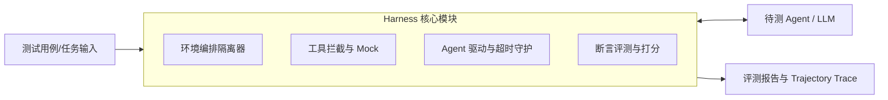
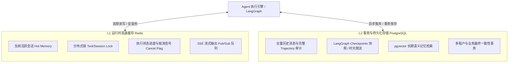
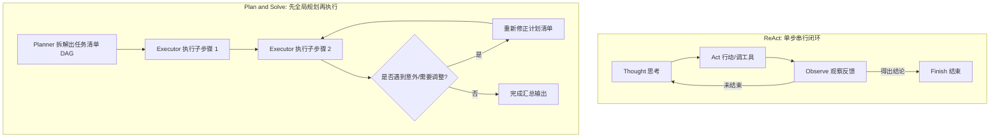
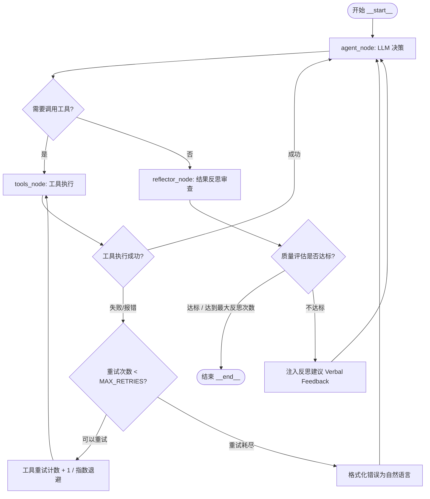
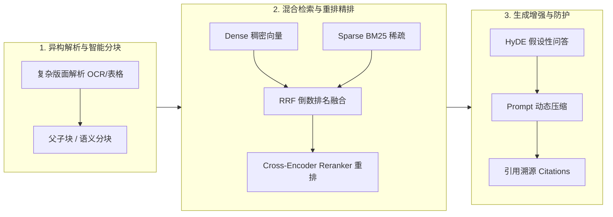

# AI Agent 与 RAG 高频实战面试题与权威题解（架构·状态管理·LangGraph·评测篇）

> 本文针对 AI Agent 应用开发与 RAG 系统架构核心面试题目（Q20 ~ Q36）进行深度复盘与权威题解，融合生产落地工程经验、架构对比模型与技术选型底层逻辑。

---

## 目录

- [Q20: Transformer 你了解过吗？](#q20-transformer-你了解过吗)
- [Q21: 模型调优有使用过吗？](#q21-模型调优有使用过吗)
- [Q22: Harness 思想、harness 模块有哪些？](#q22-harness-思想harness-模块有哪些)
- [Q23: 沙箱了解过吗？在你做的项目中遇到过吗？](#q23-沙箱了解过吗在你做的项目中遇到过吗)
- [Q24: 你做的 agent 开发是单 agent 还是多 agent？](#q24-你做的-agent-开发是单-agent-还是多-agent)
- [Q25: agent 的状态放在 redis 里还是 PGSQL 里？](#q25-agent-的状态放在-redis-里还是-pgsql-里)
- [Q26: PostgreSQL 你熟悉不熟悉？](#q26-postgresql-你熟悉不熟悉)
- [Q27: 总结一下：agent 的状态什么时候放在 redis 里？什么情况下放在 PG 里？](#q27-总结一下agent-的状态什么时候放在-redis-里什么情况下放在-pg-里)
- [Q28: Agent SDK、deep agent、claude agent，你熟悉哪种？](#q28-agent-sdkdeep-agentclaude-agent你熟悉哪种)
- [Q29: 对话历史太长，你怎么压缩？说一下具体的实现思路。](#q29-对话历史太长你怎么压缩说一下具体的实现思路)
- [Q30: 让你创建一个 agent，你觉得 agent 关键的入参是什么？](#q30-让你创建一个-agent你觉得-agent-关键的入参是什么)
- [Q31: ReAct 和 plan and executor 这两个有什么区别？](#q31-react-和-plan-and-executor-这两个有什么区别)
- [Q32: 让你用 langgraph 实现一个既有自我反思又有工具重试的智能体，你怎么设计这个架构？](#q32-让你用-langgraph-实现一个既有自我反思又有工具重试的智能体你怎么设计这个架构)
- [Q33: 你现在做的 RAG 应用文档量有多大？](#q33-你现在做的-rag-应用文档量有多大)
- [Q34: 你对 RAG 这个应用技术掌握程度怎么样？](#q34-你对-rag-这个应用技术掌握程度怎么样)
- [Q35: 怎么来提高 RAG 应用的准确度和效率？](#q35-怎么来提高-rag-应用的准确度和效率)
- [Q36: 你有什么要问我的？](#q36-你有什么要问我的)

---

### Q20: Transformer 你了解过吗？

#### 【考点分析】
考察应聘者是否真正掌握大语言模型（LLM）的底层骨架，能否跳出“上层调包开发者”的局限，深入理解注意力计算复杂度、长文本限制与显存瓶颈（KV Cache）等底层原理。

#### 【权威题解】
Transformer 是当前所有现代主流大语言模型（GPT-4、Claude、DeepSeek、Llama、Qwen 等）的基石架构。它于 2017 年在论文《Attention Is All You Need》中提出，彻底摒弃了传统 RNN/LSTM 的时序递归依赖，实现了完全并行的全序列注意力建模。

##### 1. 核心架构演进与分类
- **原始 Transformer**：标准的 **Encoder-Decoder** 架构（常用于机器翻译、T5）。
- **Encoder-only**：如 BERT，擅长双向特征抽取，主要用于判别与语义理解（嵌入模型 Embedding / 重排模型 Reranker 大多基于此）。
- **Decoder-only**：如当前绝大多数生成式 LLM（GPT 系列、DeepSeek、Llama），采用因果掩码注意力（Causal Masked Self-Attention），专精自回归文本生成。

##### 2. 核心三大要素
1. **Self-Attention（自注意力机制）**：
   - 输入向量投影为 Query ($Q$)、Key ($K$)、Value ($V$)。
   - 核心公式：
     $$\text{Attention}(Q, K, V) = \text{softmax}\left(\frac{QK^T}{\sqrt{d_k}}\right)V$$
   - 点积注意力计算词与词之间的关联权重，$\sqrt{d_k}$ 作为缩放因子防止点积过大进入 Softmax 梯度饱和区。
   - **工程演进**：从全多头注意力（MHA）演进为 **MQA (Multi-Query Attention)** 和 **GQA (Grouped-Query Attention)**，多组 Query 共享 KV 头，大幅缩减了推演时 **KV Cache** 的显存占用。
2. **Positional Encoding（位置编码）**：
   - 自注意力自身不含时序与位置感知，必须注入位置信息。
   - 经历绝对位置编码 $\to$ 相对位置编码 $\to$ **RoPE（旋转位置编码）**。RoPE 具备优秀的外推性，通过复数旋转角度赋予向量相对距离感知，是目前 Llama 和 DeepSeek 的标配。
3. **FFN（前馈神经网络）与残差结构**：
   - 采用 **Pre-LN（RMSNorm）** 代替原生的 Post-LN，提升超深网络的梯度稳定性。
   - 激活函数演进为 **SwiGLU**；当前前沿模型全面转向 **MoE（Mixture of Experts）**，如 DeepSeek-V3 仅激活部分专家，平衡海量参数与单 Token 算力消耗。

##### 3. 对 Agent 应用工程师的现实指导意义
- **$O(N^2)$ 计算复杂度**：全注意力计算与序列长度成二次方关系，解释了为什么多轮 Agent 工具调用导致 Prompt 爆炸时，首字时延（TTFT）与推理成本急剧上升。
- **KV Cache 原理**：自回归生成每吐一个词都要读取之前的 KV 缓存，理解这一点有助于理解 Prefix Caching（提示词缓存优化）的价值。

---

### Q21: 模型调优有使用过吗？

#### 【考点分析】
考察应聘者是否具备模型生命周期调优经验，能够客观、理性地评估“提示词工程”、“RAG”与“微调（Fine-Tuning）”的技术边界，避免盲目使用高成本方案。

#### 【权威题解】
在 AI Agent 与全栈落地中，调优应当遵循**“从低成本向高成本阶梯式推进”**的原则：
`Prompt Engineering (提示词/Few-Shot) -> RAG (外部检索挂载) -> PEFT 轻量微调 -> Full SFT -> RLHF / DPO`

##### 1. 模型调优方法分类与实践
- **Prompt 与 In-Context Tuning**：结构化 System Prompt（角色、执行边界、负向约束）、Few-shot 示范样本构建。
- **PEFT（参数高效微调，Parameter-Efficient Fine-Tuning）**：
  - **LoRA / QLoRA**：冻结基座权重，在注意力矩阵（$W_q, W_v$ 等）旁边注入低秩分解旁路矩阵 $\Delta W = B \times A$。以极小参数量（通常占原模型 1% 以下）实现下游领域任务适配。
- **SFT（指令微调，Supervised Fine-Tuning）**：利用特定问答对、Tool-use 轨迹（Tool Calling Schema）数据集进行监督微调。
- **DPO / PPO / GRPO（对齐与强化学习）**：如 DeepSeek-R1 采用的强化学习范式，基于规则与正确性奖励信号训练模型的逻辑思考链（CoT）。

##### 2. 什么时候“不应该”微调？
- **业务知识经常变动**：知识库有增删改查时，微调无法及时更新且有严重幻觉风险，**必须首选 RAG**。
- **通用逻辑推理**：主流顶级模型已具备充沛通用能力，单纯业务问答应先做 Prompt 调优。

##### 3. 什么时候“必须/适合”微调？
- **专有输出格式与 Function Calling 协议严格对齐**：使用小参数私有化模型（如 Qwen-7B、Llama-8B）作为本地 Agent 决策中枢时，小模型容易出现 JSON 格式损坏、非法函数调用参数，需用 Tool-call 数据集进行 LoRA 微调。
- **垂类领域语言风格/术语规范**：如医疗问诊语气、严谨法律文书范式。
- **端侧降本与延迟优化**：将大模型的 Agent 任务蒸馏微调到专用小模型上，降低 API 调用费用 90% 以上。

---

### Q22: Harness 思想、harness 模块有哪些？

#### 【考点分析】
考察专业级 AI 评测、可靠性验证及 Agent 闭环底座的认知。“Harness”在软件测试中意为“测试套件/脚手架”，在 LLM 领域特指 **Evaluation Harness**（如 `lm-evaluation-harness`、`SWE-bench harness`）以及 **Agent Execution Harness**（智能体受控执行沙箱框架）。

#### 【权威题解】

##### 1. Harness 的核心设计思想
Harness（线束/马鞍/运行基座）的核心思想是：**“将待测试/待执行的主体（Agent / Model）与外部不可靠的物理环境彻底解耦”**。
通过构建一套完全**受控、可复现、可隔离、具备确定性观测**的测试与运行台架，喂入测试用例或目标，记录其行为轨迹（Trajectory），并自动化验证结果。



##### 2. Harness 包含的核心模块
1. **Environment Setup & Teardown 模块（环境隔离与生命周期管理）**：
   - 负责每次执行前初始化独立环境（启动 Docker 容器、拉取 git commit、还原测试数据库），并在运行结束后彻底销毁、清理资源。
2. **Task & Dataset Loader 模块（任务与数据加载器）**：
   - 加载标准基准数据集（如 SWE-bench 里的 Issue、Unit Test 代码、环境依赖要求）。
3. **Agent Runtime Controller / Driver 模块（运行控制与防护）**：
   - 负责向 Agent 发送提示词，捕获其每一步 Action，设置**步数截断（Max Steps）**、**超时熔断（Timeout）**和**死循环防护**。
4. **Mock & Tool Interceptor 模块（工具拦截器）**：
   - 生产级评测不可能让 Agent 真正去连外网 API，Harness 提供网络挡板与 Deterministic Mock，保障测试结果一致性。
5. **Evaluator & Metric Reporter 模块（评测断言与指标报告）**：
   - 执行单元测试用例（如 pytest 结果断言）、LLM-as-a-Judge 语义评估、计算 Token 成本、耗时、Pass@1 准确率并输出完整报表。

---

### Q23: 沙箱了解过吗？在你做的项目中遇到过吗？

#### 【考点分析】
考察 Agent 落地过程中**生产安全防护与代码执行安全性**。当 Agent 拥有代码执行、文件系统操作或 Shell 权限时，沙箱是防范提示词注入与服务器沦陷的唯一生命线。

#### 【权威题解】

##### 1. 为什么 Agent 必须配备沙箱？
当 Agent 拥有 `python_interpreter` 或 `bash_exec` 工具时：
- **恶意注入风险**：提示词注入攻击诱导 Agent 执行 `os.system("rm -rf /")` 或上传服务器环境变量中的 API Key。
- **资源耗尽风险**：生成的死循环脚本（如 `while True`）瞬间打满 CPU 或内存导致宿主机崩溃。
- **内网横向穿透**：恶意代码借用宿主机网络扫描内网数据库或 Redis。

##### 2. 沙箱实现的演进与技术方案
| 隔离等级 | 技术方案 | 特点与安全性 | 适用场景 |
| :--- | :--- | :--- | :--- |
| **弱隔离（应用层）** | Python `exec` / `eval` + AST 语法树黑白名单 | **极不安全**。可通过反射、builtins、字符串拼接轻易绕过防御。 | 仅限玩具 Demo |
| **容器级隔离（OS 共享）** | **Docker / Podman** 容器化隔离 | 限制 `--read-only` 只读文件系统、`cgroups` 限制 CPU/内存、`drop-capabilities` 丢弃所有 root 权能。 | 中等安全企业级自建 |
| **微虚拟机级隔离（硬件虚拟化）** | **gVisor / Firecracker / Kata Containers** | 独立内核虚拟化，毫秒级冷启动，提供真正物理/硬件级安全边界。 | 生产级云服务（AWS Lambda、E2B） |
| **托管沙箱生态** | **E2B / Modal / Daytona** | 专为 AI Agent 设计的开源与 SaaS 沙箱，支持 Python/Node 环境及文件持久化同步。 | 快速交付的 AI 应用 |

##### 3. 项目实战落地细节
在数据分析 Agent 项目中，采用 **“无状态 Docker 容器沙箱 + 挂载只读数据卷 + 内部独立网络隔离”**：
- 容器启动参数限定 `--network none`（禁止一切外网访问，防止数据外泄）。
- 挂载工作目录为独立 tmpfs（内存盘），限制执行时间不超过 15 秒、内存上限 512MB。
- 容器标准输出（stdout/stderr）以及生成的图表文件提取回主进程后，立即销毁容器。

---

### Q24: 你做的 agent 开发是单 agent 还是多 agent？

#### 【考点分析】
考察应聘者的架构辨别力与实战求真态度。**忌讳一味盲目鼓吹 Multi-Agent**。合格的架构师会基于任务复杂度、成本与收敛性做理性抉择。

#### 【权威题解】
> **标准回答策略**：以 **“Single-Agent + 工具扩展” 为基础主力落地，在“高度专业异构分工与长上下文隔离”场景演进为“分层 Multi-Agent”**。

##### 1. 为什么 80% 的业务场景首选 Single-Agent？
- **确定性与排障友好**：单一状态线，轨迹（Trajectory）极度清晰，排查死循环与幻觉代价小。
- **延迟与成本低**：多 Agent 之间由于频繁互相通信协商，Token 消耗呈指数级激增，端到端延迟（TTFT）难以满足 C 端用户的交互要求。
- **落地场景**：智能客服问答、企业内部 API 调度助手、常规数据看板生成。

##### 2. 什么时候必须引入 Multi-Agent？
当出现以下三个核心特征时，单 Agent 必然失效：
1. **职责异构度极高**：角色关注点互斥，例如“代码生成 Agent”追求快速产出，而“代码安全审查 Agent”专注于找漏洞，单 Prompt 角色扮演容易互相稀释。
2. **上下文过载（Context Pollution）**：一个大任务涉及几万行代码，单 Agent 上下文会迅速被污染并遗忘细节，需要不同子 Agent 独立维护自己的局部 Memory。
3. **流程需要对抗与审批（Critic/Reviewer 机制）**：引入评价者 Agent 进行自纠自查（如 Reflexion 模式）。

##### 3. 生产实践架构（Supervisor 主管分层模式）
在复杂研报系统项目中，采用 **Supervisor（主管）模式**：
- **Router / Supervisor Agent**：负责顶层任务分解与调度，不直接干脏活。
- **Sub-Agent 1（数据收集者）**：携带 RAG 与搜索工具，专注于获取行业数据并输出事实列表。
- **Sub-Agent 2（图表与分析者）**：根据事实列表写 Python 沙箱代码画图。
- **Sub-Agent 3（审核与合规者）**：校验数字准确度，不合格则打回给前置 Agent 重试。

---

### Q25: agent 的状态放在 redis 里还是 PGSQL 里？

#### 【考点分析】
考察分布式架构下的状态持久化选型。优秀候选人不会回答非此即彼，而是阐明**分层状态存储（Tiered State Architecture）**的理念。

#### 【权威题解】
**结论：两者各司其职，采用“Redis 做热态与中间运行时，PostgreSQL 做冷态持久化与审计快照”的双层架构。**



---

### Q26: PostgreSQL 你熟悉不熟悉？

#### 【考点分析】
为什么现代 AI / Agent 领域对 PostgreSQL 的偏好远高于 MySQL？考察候选人对 PG 的多模态能力（JSONB、pgvector、全文检索、事务能力）的理解。

#### 【权威题解】
我对 PostgreSQL 非常熟悉。在 AI 时代的工程落地中，PostgreSQL 已经从传统的“关系型数据库”跃迁为**全能型 AI 底座**，核心体现在以下几项关键技术特性：

1. **`pgvector` 原生向量检索扩展**：
   - 支持通过 SQL 直接执行向量的余弦相似度、L2 距离与点积运算。
   - 支持 **HNSW** 与 **IVFFlat** 索引，百万级向量检索毫秒级响应。
   - **最大优势**：消除了引入外置专用向量库（如 Pinecone/Milvus）带来的运维复杂度，使得“业务数据关联查询”与“语义向量检索”能在一条 SQL 事务内完成（真正的 Hybrid Search）。
2. **强大的 `JSONB` 支持与 GIN 索引**：
   - Agent 的中间状态（State Dictionary）、Tool Call 参数、返回值 Schema 是动态半结构化的。PG 的 JSONB 具备高性能二进制存储与路径检索，配合 GIN 索引可实现对任意嵌套字段的极速过滤。
3. **LISTEN / NOTIFY 异步事件发布订阅**：
   - 在轻量级场景下，直接利用 PG 自身的消息总线通知后端 Worker 唤醒暂停的长任务，无需额外部署 RabbitMQ。
4. **丰富的并发控制与成熟事务（MVCC）**：
   - 保证长事务状态变更（如 Agent 自动扣款或修改订单）时业务的一致性与回滚机制。

---

### Q27: 总结一下：agent 的状态什么时候放在 redis 里？什么情况下放在 PG 里？

#### 【考点分析】
考察系统设计的抽象总结与分类决策能力。

#### 【权威题解】

| 存储介质 | 存放的状态类型 | 核心场景与典型字段 | 技术原因 |
| :--- | :--- | :--- | :--- |
| **Redis** | **瞬时状态 (In-flight State)** | 任务执行进度（Progress: 45%）、当前运行的 Step 计数。 | 毫秒级写入，高频无感刷新。 |
| **Redis** | **分布式锁 (Locks)** | `session_lock:{thread_id}`、工具调用幂等锁。 | 防止用户快速连续点击产生并发竞争。 |
| **Redis** | **中断与控制信号 (Signal)** | 用户点击“停止生成”的 `cancel_flag`。 | 需要 Agent 的下一循环步能瞬时探测。 |
| **Redis** | **热点上下文缓存 (Hot Cache)** | 最近 3~5 轮对话的未压缩消息。 | 避免每次思考都要穿透到磁盘数据库。 |
| **Redis** | **流式传输管道 (Streaming)** | SSE 打字机流式输出的缓冲队列。 | 内存管道传输，用完即弃。 |
| **PostgreSQL** | **持久化工作流快照 (Checkpoints)** | LangGraph 的全量状态图版本（Thread Checkpointer）。 | 支持“人工介入审批（HITL）”唤醒、长任务断点续跑、版本时光倒流。 |
| **PostgreSQL** | **全量审计轨迹 (Audit Logs)** | 包含每一次思考、调用工具入参、环境原始返回的 Trajectory。 | 满足可观测性（Observability）、安全合规与模型离线评测（Evals）。 |
| **PostgreSQL** | **长期记忆与实体 (Long-term Memory)** | 提取出的用户偏好、业务画像（利用 `pgvector`）。 | 跨会话长期留存，需做混合查询与语义匹配。 |
| **PostgreSQL** | **涉及业务强事务的数据** | 订单状态、扣除积分、写入业务数据表。 | 必须依赖 ACID 保证最终一致性。 |

---

### Q28: Agent SDK、deep agent、claude agent，你熟悉哪种？

#### 【考点分析】
考察候选人的技术广度与核心工具选型沉淀。

#### 【权威题解】
这三者分别代表了当前 AI Agent 开发的**不同层次和技术路线**：

1. **主流开源 Agent SDK（以 LangGraph / LangChain、LlamaIndex、CrewAI 为代表）**：
   - **特点**：工程化程度最高、通用性最强。
   - **核心掌握**：重点掌握 **LangGraph**。它通过“状态图（StateGraph）+ 节点（Node）+ 条件边（Conditional Edge）”的显式状态机设计，彻底解决了传统 LangChain `AgentExecutor` 黑盒不易控的问题，原生支持持久化 Checkpoint、循环流转、人工介入审批（Human-in-the-Loop）。
2. **Deep Agent（深度研究/长链推理型 Agent，如 OpenAI Deep Research、DeepSeek-R1 范式）**：
   - **特点**：专注于**开放式、多步骤长耗时、深度探索**的场景。
   - **核心机制**：不仅仅是线性执行，而是结合了**蒙特卡洛树搜索（MCTS）/ 树状思考（Tree of Thoughts）**，具备多分支并行探索、遇阻自动回溯剪枝、多源信息交叉验证的能力。
3. **Claude Agent（Anthropic Claude Tool Use / Computer Use / Claude Code）**：
   - **特点**：模型与工具生态深度定制的典范。
   - **核心优势**：
     - **Prompt Caching（提示词缓存）**：显著降低长上下文工具描述与历史消息的调用成本与首字延迟。
     - **Computer Use（计算机操作能力）**：原生支持截屏感知、坐标推算、键鼠交互，是目前最接近“自主使用电脑”的官方 Agent 范式。

---

### Q29: 对话历史太长，你怎么压缩？说一下具体的实现思路。

#### 【考点分析】
考验工程实战中的 Context 窗口管理能力。这是每一个生产环境 Agent 都会遭遇的痛点（Token 成本、模型注意力被稀释“Lost in the middle”、超出模型 Context 长度）。

#### 【权威题解】
在生产环境中，单凭一种策略无法完美解决问题，我们通常采用**分阶段渐进式压缩流水线（Progressive Compression Pipeline）**：

```mermaid
flowchart TD
    Input[用户最新消息] --> Check{当前 Context Token 统计}
    Check -->|< 阈值 (如 60%)| Direct[直接进入模型推理]
    Check -->|> 阈值 (如 80%)| Stage1[第一阶段：清洗 Tool Observation 冗余文本]
    Stage1 --> Check2{Token 是否安全?}
    Check2 -->|是| Direct
    Check2 -->|否| Stage2[第二阶段：滑动窗口 + 增量式递归摘要]
    Stage2 --> Stage3[第三阶段：结构化实体抽取与长期记忆外置 RAG]
    Stage3 --> Direct
```

##### 具体实现思路与步骤：
1. **Tool Observation 动态剪枝（收益最高、无损语义）**：
   - Agent 调工具时，往往会抓取几十 KB 的原始 HTML 或巨型 JSON 数据。
   - **思路**：一旦模型已经基于这些工具结果推理出了结论并输出了下一步思考，历史消息中的这部分原始 Observation 就失去了直接价值。可将旧轮次的工具返回结果截断替换为：`"[Data retrieved and analyzed: summarized 2KB of logs]"`，瞬间缩减 70% 的无用 Token。
2. **滑动窗口（Sliding Window）与分区保留**：
   - 保证 `System Prompt` 绝对常驻。
   - 保留最近 $N$ 轮（如最近 3 轮）原汁原味的对话，确保即时短期连贯性。
3. **增量式语义摘要（Progressive Summarization）**：
   - 当上下文触碰警戒水位（如超过 80%），调用廉价高速模型（如 GPT-4o-mini 或 DeepSeek-V3），将早期窗口内的多轮对话提炼成一段紧凑的结构化 Markdown 摘要：
     ```markdown
     【历史关键事实摘要】
     - 用户目标：排查北京节点订单超时问题
     - 已执行：检查了 Nginx 日志与 Redis 延迟，发现均正常
     - 当前结论：怀疑是下游支付网关丢包
     ```
   - 随后的对话中，直接将该摘要作为一条上下文系统消息注入。
4. **外置长期语义记忆检索（MemGPT / RAG 模式）**：
   - 将被淘汰出窗口的早期历史消息打上时间戳后落库（向量化）。当用户后续突然询问远期历史（“刚才我说的那个数据库账号是多少来着？”）时，通过语义相似度检索按需将历史事实捞回。

---

### Q30: 让你创建一个 agent，你觉得 agent 关键的入参是什么？

#### 【考点分析】
考察系统架构抽象能力与接口设计水平。优秀的入参设计应遵循单一职责、高内聚低耦合与工业级防御性编程原则。

#### 【权威题解】
设计一个工业级可维护的 Agent 实例，其构造入参可以高度抽象为**四大核心维度**：

```python
class Agent:
    def __init__(
        self,
        # 1. 核心大脑 (Brain)
        model: BaseChatModel,              # 模型实例 (如 ChatOpenAI, 包含温度、超时等)
        system_prompt: str,                 # 系统指令/角色规范/行为准则
        few_shot_examples: list[dict] = [], # 少样本示例 (引导格式与推理路线)

        # 2. 工具与环境能力 (Capabilities)
        tools: list[BaseTool] = [],         # 注册的工具清单 (带 Pydantic Schema 与权限等级)
        sandbox: Optional[Sandbox] = None,  # 可选的外部受控执行环境 (Docker/MicroVM)

        # 3. 记忆与状态持久化 (Memory & State)
        checkpointer: BaseCheckpointer = None, # 状态快照保存器 (Redis / Postgres)
        state_schema: Type[BaseModel] = None,  # 状态数据结构契约 (TypedDict 或 Pydantic)
        memory_retriever: Optional[Retriever] = None, # 长期外置记忆检索器

        # 4. 控制策略与安全护栏 (Control & Guardrails)
        max_iterations: int = 15,           # 最大迭代思考步数 (防死循环熔断)
        timeout_seconds: float = 60.0,       # 端到端最大超时时间
        interrupt_before_tools: list[str] = [], # 人工介入审批断点 (HITL)
        guardrails: list[BaseGuardrail] = [] # 输入/输出敏感词与注入安全审计拦截器
    ):
        ...
```

---

### Q31: ReAct 和 plan and executor 这两个有什么区别？

#### 【考点分析】
考察对 Agent 经典决策范式的认知深度与选型能力。

#### 【权威题解】

##### 1. 机制与决策链路对比


##### 2. 核心维度详细对比表

| 维度 | ReAct (Reasoning + Acting) | Plan-and-Executor (规划与执行) |
| :--- | :--- | :--- |
| **决策模式** | 局部微观视角：走一步看一步，单步循环。 | 全局宏观视角：一次性规划完整子步骤再分步执行。 |
| **复杂任务分解能力** | 较弱。任务超过 10 步时容易迷失大方向、陷入局部死循环。 | **极强**。先拆成子任务树，逻辑极其严密。 |
| **灵活性与容错性** | **极高**。每一步都能根据最新的工具报错迅速调整决策。 | 稍差。如果外部环境剧烈变化，频繁触发 Replanner 成本高。 |
| **并发能力** | 只能单步串行推理。 | **支持多子任务并行执行**（如果子任务间无依赖）。 |
| **Token 与时延** | 长链条下上下文累积迅速，容易出现上下文膨胀。 | 规划完成后，各子任务的执行上下文独立干净，综合 Token 往往更省。 |
| **最佳适用场景** | 探索型即时查询、客服咨询、简单的 Shell 命令排查。 | 深度分析报告撰写、跨多系统批量数据对齐、复杂代码工程重构。 |

---

### Q32: 让你用 langgraph 实现一个既有自我反思又有工具重试的智能体，你怎么设计这个架构？

#### 【考点分析】
这是目前国内大厂针对 Agent 架构落地考察最高频的**系统设计实战题**。考验你对 LangGraph 状态图的掌控（Nodes、Edges、State 字典流转、Conditional Routing）。

#### 【权威题解】

##### 1. 架构拓扑流转图


##### 2. 状态结构设计（AgentState）
```python
from typing import TypedDict, Annotated, List, Dict
from langgraph.graph.message import add_messages

class AgentState(TypedDict):
    # 消息对话流（内置自动追加机制）
    messages: Annotated[List[dict], add_messages]
    # 工具重试计数器: { "tool_call_id_1": 2 }
    tool_retry_counts: Dict[str, int]
    # 反思重试总次数
    reflection_count: int
    # 最终业务验收状态
    is_satisfied: bool
```

##### 3. 核心节点与分支路由代码实现（骨架）
```python
from langgraph.graph import StateGraph, END
from langchain_core.messages import HumanMessage, AIMessage, ToolMessage

MAX_TOOL_RETRIES = 3
MAX_REFLECTIONS = 2

# 1. 决策节点
def agent_node(state: AgentState):
    # 调用 LLM，绑定可用 tools
    response = llm_with_tools.invoke(state["messages"])
    return {"messages": [response]}

# 2. 工具执行与捕获节点
def tools_node(state: AgentState):
    last_message = state["messages"][-1]
    results = []
    retry_counts = state.get("tool_retry_counts", {}).copy()
    
    for tool_call in last_message.tool_calls:
        call_id = tool_call["id"]
        try:
            # 尝试执行具体工具
            out = execute_tool(tool_call["name"], tool_call["args"])
            results.append(ToolMessage(content=str(out), tool_call_id=call_id))
        except Exception as e:
            # 记录重试次数
            current_retry = retry_counts.get(call_id, 0)
            if current_retry < MAX_TOOL_RETRIES:
                retry_counts[call_id] = current_retry + 1
                # 重新尝试或返回给模型提示其换参数
                results.append(ToolMessage(
                    content=f"Error executing {tool_call['name']}: {str(e)}. Please retry or correct parameters.",
                    tool_call_id=call_id
                ))
            else:
                results.append(ToolMessage(
                    content=f"Fatal: Tool {tool_call['name']} failed after {MAX_TOOL_RETRIES} attempts.",
                    tool_call_id=call_id
                ))
                
    return {"messages": results, "tool_retry_counts": retry_counts}

# 3. 反思审查节点 (Reflector)
def reflector_node(state: AgentState):
    last_ai_msg = state["messages"][-1].content
    # 用独立的 Evaluator 模型或严格 Prompt 评估生成结果
    eval_prompt = f"请严格评估以下回答是否满足用户需求，存在逻辑漏洞或格式问题直接指出：\n{last_ai_msg}"
    eval_result = evaluator_llm.invoke(eval_prompt).content
    
    current_reflections = state.get("reflection_count", 0)
    passed = "PASS" in eval_result.upper()
    
    if not passed and current_reflections < MAX_REFLECTIONS:
        feedback = f"【反思纠错建议】：你的回答存在以下不足：{eval_result}，请修正后重新作答。"
        return {
            "messages": [HumanMessage(content=feedback)],
            "reflection_count": current_reflections + 1,
            "is_satisfied": False
        }
    return {"is_satisfied": True}

# 4. 路由逻辑
def check_next_step(state: AgentState):
    last_msg = state["messages"][-1]
    if hasattr(last_msg, "tool_calls") and len(last_msg.tool_calls) > 0:
        return "tools_node"
    return "reflector_node"

def check_reflection_status(state: AgentState):
    if state.get("is_satisfied", False):
        return END
    return "agent_node"

# 5. 构建 LangGraph
builder = StateGraph(AgentState)
builder.add_node("agent_node", agent_node)
builder.add_node("tools_node", tools_node)
builder.add_node("reflector_node", reflector_node)

builder.set_entry_point("agent_node")
builder.add_conditional_edges("agent_node", check_next_step)
builder.add_edge("tools_node", "agent_node")
builder.add_conditional_edges("reflector_node", check_reflection_status)

app = builder.compile(checkpointer=postgres_saver)
```

---

### Q33: 你现在做的 RAG 应用文档量有多大？

#### 【考点分析】
考察工程经验的真实性与规模化容量设计认知。切忌报“玩具项目”的几百页，也切忌盲目乱吹“几十亿篇文档”。必须从**文档量、分块数（Chunks）、存储容量与物理显存**给出合理的工程指标。

#### 【权威题解】
> **推荐回答范式**（以中大型企业级生产级规模为例）：

“目前我们落地生产的 RAG 知识库系统，规模整体处于**数十万级文档、数百万级向量切片（Chunks）**体量：
1. **源文档规模**：企业知识库累计约 **8 万 ~ 15 万份文档**（包括内部研发规范、接口文档、合同扫描件、PDF 产品手册及 FAQ）。
2. **切片 Chunk 规模**：按照 500~800 Token 的语义切片规则，并剔除无意义空内容后，向量数据库中实际存量向量在 **120 万 ~ 200 万条** 之间。
3. **向量维度与存储开销**：
   - 采用 1024 维的开源优质嵌入模型（如 `BGE-large-zh-v1.5`），单向量约占 4KB（FP32）。
   - 200 万向量原始数据约 8GB，配合 **HNSW 索引**（$M=16, efConstruction=200$），内存常驻开销在 **16GB ~ 24GB** 左右。
4. **扩展性策略**：我们采用了**基于租户与业务域的物理分区（Partition / Namespace）**隔离，高频业务数据常驻内存，冷门历史归档走磁盘倒排索引，保证 P95 检索延迟控制在 50ms 以内。”

---

### Q34: 你对 RAG 这个应用技术掌握程度怎么样？

#### 【考点分析】
考察技术全貌视野与阶梯式进阶能力（区分仅仅停留在 `Naive RAG` 的新手与掌握 `Modular/Agentic RAG` 的资深架构师）。

#### 【权威题解】
我深入掌握了 RAG 架构从 **Naive RAG（初级） $\to$ Advanced RAG（高级工程化） $\to$ Modular / Agentic RAG（智能体自适应）** 的全套体系，并在生产环境中主导过完整的落地调优闭环：



1. **预处理与文档分块层（Data Preparation）**：
   - 深刻理解“Garbage in, Garbage out”。擅长处理复杂 PDF 版面（表格结构化重建、层级标题树还原）。
   - 拒绝机械等长切分，采用**语义边界分块（Semantic Chunking）**与**父子块（Parent-Document Retrieval / Small-to-Big）**：用短切片做高命中检索，用父级大块提供完整上下文。
2. **检索增强与混合召回层（Retrieval Optimization）**：
   - 熟练落地 **Hybrid Search（混合检索）**：稠密语义向量（捕捉意图） + 稀疏关键词 BM25（解决特定产品型号、货号、函数名的精准匹配），使用 **RRF（Reciprocal Rank Fusion）** 融合。
   - 引入 **Cross-Encoder 重排模型（BGE-Reranker）**，对 Top-50 粗排结果打分筛选出 Top-5 精排输入，显著压低无关噪声。
3. **Agentic RAG（动态检索交互）**：
   - 掌握 **Self-RAG** 与 **Corrective RAG (CRAG)**：让大模型先评估检索内容与问题的相关度，若相关度不足，自动触发查询改写（Query Rewrite）或降级联网搜索，彻底杜绝盲目生成。

---

### Q35: 怎么来提高 RAG 应用的准确度和效率？

#### 【考点分析】
RAG 最经典、最硬核的系统性大题。涵盖**召回准确率（Precision/Recall）、生成幻觉率（Hallucination）、首字时延（TTFT）与计算成本**。

#### 【权威题解】

##### 1. 提高准确度（Accuracy & Groundedness）的 4 大抓手
1. **优化 Chunk 策略（解决 Context 碎片化）**：
   - **Small-to-Big / 父子块检索**：向量化只对 150 Token 的叶子节点计算（提升相似度匹配纯度），但最终塞给 LLM 的是包含上下文的 800 Token 父块。
   - **元数据丰富（Metadata Enrichment）**：为每个 Chunk 自动生成标题路径、摘要、关键词作为元数据过滤条件。
2. **混合检索 + Rerank 机制（解决相关性不足）**：
   - 单纯向量检索对专有名词敏感度低，必须组合 **BM25 全文检索**。
   - 必须配置 **Reranker（如 Cohere 或 BGE-Reranker）**，过滤语义漂移严重的假相关片段。
3. **查询端变换（Query Transformation）**：
   - **Query Rewrite**：将多轮对话中的代词指代还原（例如把“它的价格呢？”补全为“iPhone 16 Pro 的官方售价是多少？”）。
   - **HyDE（假设性文档嵌入）**：让大模型先根据问题写一段虚构的可能回答，再拿这段回答去匹配向量库，通常匹配度远高于用生硬短问题去匹配。
4. **提示词防幻觉约束（Prompt Guardrails）**：
   - 强制模型遵循：“仅根据下述参考文档回答，若文档未提及请明确说明‘依据现有资料无法解答’，严禁自行脑补”，并强制输出 `[引用来源编号]` 锚点。

##### 2. 提高系统效率与性能（Latency & Throughput）的 4 大抓手
1. **语义缓存机制（Semantic Cache）**：
   - 使用 **GPTCache / Redis** 缓存高频历史问题。当用户提问与缓存库问题余弦相似度 $>0.95$ 时，直接返回缓存回答，延迟从 3000ms 降至 20ms。
2. **多路召回异步并行化（Async Concurrency）**：
   - 将向量检索、BM25 检索、敏感词过滤三路操作通过 `asyncio.gather` 并行执行，缩减单步等待时间。
3. **向量量化压缩（Quantization）**：
   - 使用 **PQ（乘积量化）** 或 **SQ8（标量量化）**，在仅损失约 1% 召回率的前提下，降低 75% 的内存占用并提升检索速度 3~5 倍。
4. **Context 压缩与 Token 精简**：
   - 采用 **LLMLingua** 等轻量感知模型，剔除 Prompt 中的冗余助词与无用符号，显著降低传入大模型的 Token 量，大幅提升首字流式输出时间（TTFT）。

---

### Q36: 你有什么要问我的？

#### 【考点分析】
反向提问是展现你的**职业成熟度、技术追求、对业务的深度洞察**的绝佳机会。切忌回答“没有了”，也不要只问非技术的福利作息。

#### 【高分反问策略与话术参考】

##### 角度 1：探寻团队当前的业务阶段与核心痛点（展现架构落地敏锐度）
> “请教一下，咱们团队目前在落地 Agent / RAG 项目时，当前阶段最大的挑战是处于**‘从 0 到 1 探索业务闭环’**，还是已经到了**‘在多工具、复杂高并发场景下解决收敛性、确定性与模型幻觉’**的深水区阶段？”

##### 角度 2：探寻技术栈选型与团队技术路线（展现技术专业度）
> “在 Agent 编排与底层底座方面，团队目前更倾向于基于 **LangGraph 这类图状态机方案**，还是走**纯自研轻量工作流**？另外针对开源私有化模型（如 DeepSeek、Qwen）与闭源商业 API，咱们内部的落地权重通常是如何分配的？”

##### 角度 3：探寻评测与可观测性体系（展现高阶工程素养）
> “因为大模型具备天然的不确定性，咱们团队在生产环境中是如何建立 **Evals（自动化评测体系）** 和持续可观测性闭环的？通常是以 LLM-as-a-Judge 为主，还是结合了业务埋点与人工标注回流？”

