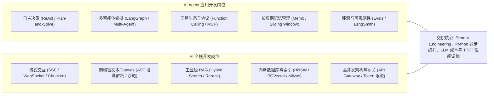

# AI Agent 应用开发 vs AI 全栈开发 核心面试知识图谱与全景指南

---

## 岗位画像与考察维度对比

在当今的大模型与 AI 原生应用开发市场中，**AI Agent 应用开发工程师** 与 **AI 全栈工程师** 虽然都围绕大模型构建应用，但在能力侧重与面试考察重心上有明确的分工边界：



| 维度 | AI Agent（AI 应用开发）岗位 | AI 全栈开发岗位 |
| :--- | :--- | :--- |
| **核心职责** | 专注于大模型的**逻辑闭环、复杂任务拆解、多工具调用、自主容错与跨智能体协同**。 | 专注于**端到端产品实现、高并发后端服务、前端极致交互体验（Canvas/流式）、知识库检索（RAG）与云原生基础设施**。 |
| **主力技术栈** | LangGraph, CrewAI, AutoGen, MCP, Pydantic, DSPy, LangSmith / Phoenix | Next.js / React, FastAPI, Python/TypeScript, PGVector / Qdrant, Redis, Docker / K8s |
| **算法/工程比** | 60% 提示工程与智能体控制流 + 40% 业务工程 | 70% 全栈 Web 与分布式工程 + 30% AI 算法接口集成 |
| **典型代表项目** | 自动化运维排障智能体、代码自动重构 Agent、金融多工具投研助理 | 类似 Cursor / Claude Artifacts 的 Canvas、企业级百万知识库问答系统、生产级大模型 API 网关 |

---

## 核心速查思维导图（Cheat Sheet）

### 1. AI Agent 核心高频考点速记
- **决策范式**：
  - `ReAct`：单步闭环（Thought $\to$ Action $\to$ Observation），探索试错强，容易局部死循环。
  - `Plan-and-Solve`：先拆 DAG 再按序执行，全局大局观好，抗干扰偏弱。
  - `Reflexion`：引入 Evaluator 反思经验循环，适合复杂攻坚与代码修复，延迟高。
- **工具协议演进**：
  - 传统 Function Calling：硬编码 JSON Schema，单体强耦合。
  - **MCP (Model Context Protocol)**：开放 JSON-RPC 2.0 标准，解耦 Tools、Resources、Prompts 三位一体，跨平台即插即用。
- **记忆与降本**：
  - 静态部分（System Prompt + Tools 定义）前置 $\to$ 稳定命中 **Prompt Caching**。
  - 工具返回大文本必须做结构化摘要压缩，避免 Scratchpad 恶性膨胀。
  - 应用层死循环检测器（Loop Detector）防刷与硬性 `max_steps` 熔断。

### 2. AI 全栈核心高频考点速记
- **流式通信协议**：
  - 对话流首选 **SSE**（标准 HTTP、穿透代理、内置重连）；多模态双向语音首选 **WebSocket**。
  - 前端利用 `AbortController` 绑定 `signal`，后端捕获连接断开及时终止上游 LLM 计费。
- **前端流式渲染细节**：
  - 代码块未闭合导致闪烁 $\to$ 正则启发式补全结尾 `\n``` `。
  - Mermaid / KaTeX 渲染报错 $\to$ 处于流式接收时仅做纯文本或骨架占位，流式结束后再触发批量编译。
- **RAG 工业级落地金标准**：
  - 摒弃简单切分，采用 **父子切分（Parent-Child）** 或 **语义切分（Semantic Chunking）**。
  - **双路检索（Dense + Sparse BM25）** 解决语义关联与精确料号/代码匹配。
  - **RRF (Reciprocal Rank Fusion)** 无参融合后，使用 **Cross-Encoder Reranker** 精排 Top-5。
- **TTFT（首字时间）全链路压降**：
  - TCP 连接池预热 + 服务端 Prompt Caching + Nginx 关闭代理缓冲（`proxy_buffering off;`）+ 并发检索。

---

## 本地题库文件索引

完整的两套高质量面试题与详细题解已写入你的工作区：

1. **AI Agent 应用开发岗位题库**：
   - 📄 [01_AI_Agent应用开发岗位_高频面试题与权威题解.md](file:///Users/kevinzzzzzzz/Documents/Code/AIAPP_learning/面试题准备/01_AI_Agent应用开发岗位_高频面试题与权威题解.md)
   - 涵盖：ReAct/Reflexion 演进、Function Calling 底层协议、MCP 标准、记忆管理、多智能体拓扑、Evals 评测可观测性、500+ 工具动态挂载架构、长运行任务状态机、提示词注入防护等。

2. **AI 全栈开发岗位题库**：
   - 📄 [02_AI全栈开发岗位_高频面试题与权威题解.md](file:///Users/kevinzzzzzzz/Documents/Code/AIAPP_learning/面试题准备/02_AI全栈开发岗位_高频面试题与权威题解.md)
   - 涵盖：SSE vs WebSocket、前端 Markdown/Mermaid 流式渲染闪烁治理、工业级 RAG 全生命周期、HNSW 与向量数据库选型、语义缓存与 Prompt 缓存协同、FastAPI 异步并发陷阱、企业级多租户 RAG 设计、类似 Cursor Artifacts Canvas 架构、TTFT 极致优化与线上 429 容灾熔断等。

